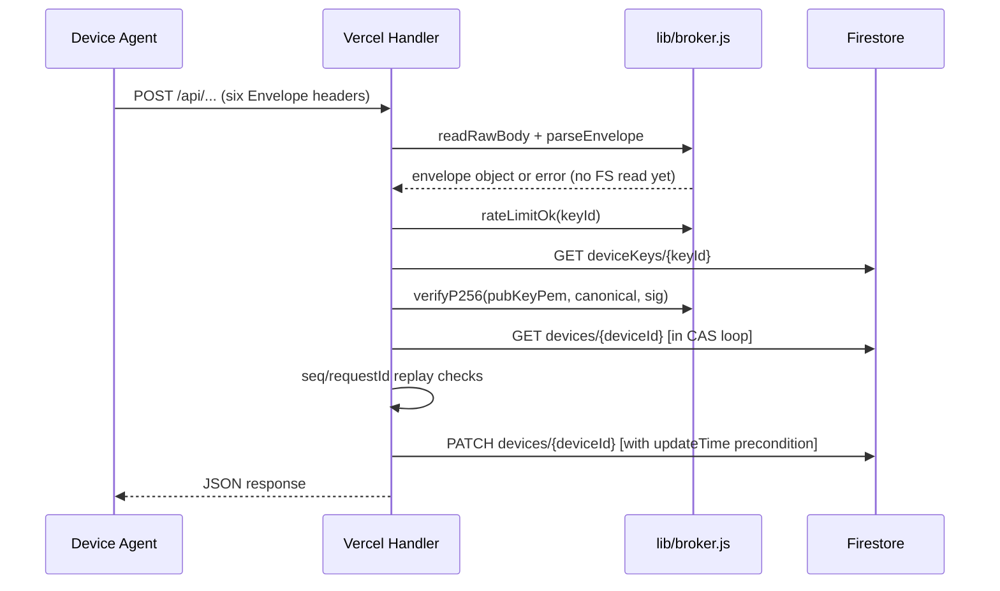
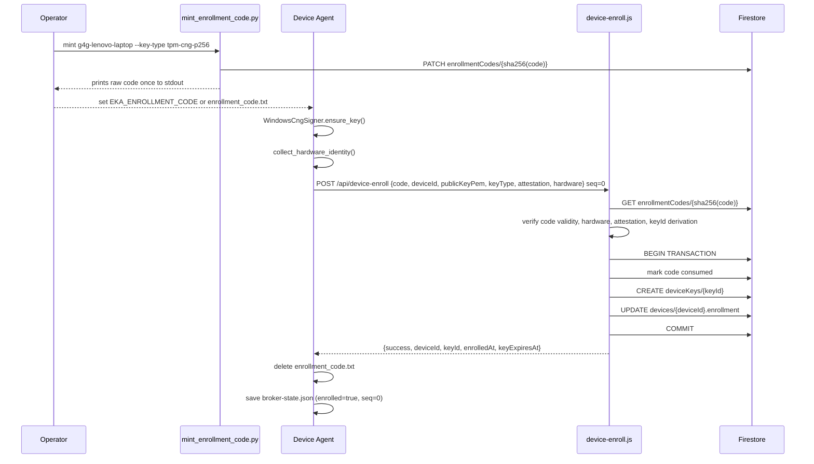
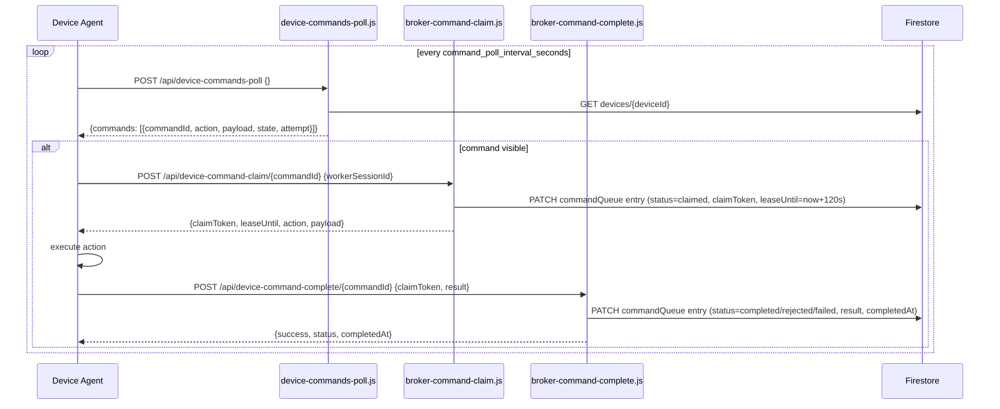

# Design Document

## Broker v2 Device Enrollment Control Plane

---

## Overview

The Broker v2 Control Plane is the secure, zero-trust identity and command
backbone for a small fleet of three personally-owned machines:

| Device ID | Platform | Signer |
|---|---|---|
| `g4g-lenovo-laptop` | Windows 11, Lenovo G4G | `WindowsCngSigner` (TPM-CNG, non-exportable) |
| `jayti-asus-vivobook` | Linux/Windows, ASUS VivoBook | `WindowsCngSigner` (TPM-CNG, non-exportable) |
| `samsung-s24-ultra` | Android 14, Samsung S24 Ultra | `TermuxKeystoreSigner` (AndroidKeyStore, secure element) |

Every device runs a Python daemon (`device_agent.py`) that dials **out** over
public HTTPS to a Vercel-hosted serverless API (`jayti-dashboard`). There is no
inbound connectivity requirement. The server is backed exclusively by Cloud
Firestore (`eka-agent` database). Identity is derived server-side from a
cryptographically verified P-256 key; the client-supplied `deviceId` is
authoritative only during the one-time enrollment handshake.

The control plane covers six concerns:

1. **Request envelope authentication** — every API call carries a signed header
   block that the server verifies before touching Firestore.
2. **Enrollment** — one-time, code-gated, hardware-fingerprint-bound pairing
   that issues a 180-day device key.
3. **Heartbeat** — periodic liveness + telemetry push with hardware re-verification.
4. **Command pipeline** — server-enqueued commands polled, claimed (with a
   120-second lease), and completed by the agent.
5. **Key lifecycle** — expiry, revocation, and suspension enforcement on every
   request.
6. **Liveness monitoring** — stale-device detection via a 5-minute Vercel cron
   with email alerting.

---

## Architecture

### System Topology

```mermaid
graph TB
    subgraph Devices
        A[Lenovo G4G\nWindowsCngSigner\nTPM-CNG P-256]
        B[ASUS VivoBook\nWindowsCngSigner\nTPM-CNG P-256]
        C[Samsung S24\nTermuxKeystoreSigner\nAndroidKeyStore P-256]
    end

    subgraph Vercel Serverless
        E[device-enroll.js]
        H[device-heartbeat.js]
        P[device-commands-poll.js]
        CL[broker-command-claim.js]
        CO[broker-command-complete.js]
        CS[check-stale.js\n5-min cron]
        LIB[lib/broker.js\nshared library]
    end

    subgraph "Cloud Firestore (eka-agent)"
        FS1[devices/\n{deviceId}]
        FS2[deviceKeys/\n{keyId}]
        FS3[enrollmentCodes/\n{codeHash}]
        FS4[auditLog/\n{auto}]
    end

    subgraph "Admin (operator's machine)"
        MT[mint_enrollment_code.py\nGoogle ADC]
    end

    A & B & C -- "HTTPS POST\nsigned envelope" --> E & H & P & CL & CO
    MT -- "Firestore REST" --> FS3
    E & H & P & CL & CO --> LIB
    LIB --> FS1 & FS2 & FS3 & FS4
    CS --> FS1
    CS -- "SMTP via Gmail" --> Email[Alert Recipients]
```

### Request Lifecycle

Every authenticated request follows the same pattern regardless of endpoint:



### Enrollment Flow



### Command Pipeline



---

## Components and Interfaces

### Server: `lib/broker.js` (Shared Library)

All handler files import from this single module. Key exports:

| Export | Type | Purpose |
|---|---|---|
| `parseEnvelope(req, rawBody, canonicalPath)` | function | Validates all six headers, checks timestamp window, builds canonical string and body SHA-256 |
| `verifyP256(publicKeyPem, canonical, signatureB64)` | function | ECDSA P-256 signature verification via `crypto.createVerify('SHA256')` |
| `rateLimitOk(keyId)` | function | In-memory 30 req/60s sliding window per keyId |
| `fsGet(path)` | async function | Firestore GET with bearer token |
| `fsPatch(path, fields, precondition)` | async function | Firestore PATCH with `updateMask` and optional `updateTime` precondition |
| `fsBeginTransaction()` / `fsCommit()` / `fsRollback()` | async functions | Firestore multi-document transaction |
| `enc(v)` / `dec(v)` | functions | Firestore value serialization/deserialization |
| `expandFieldPaths(values)` | function | Expands dot-notation keys into nested structures for PATCH |
| `findIdempotentResult(enrollment, env, canonicalPath)` | function | Checks `enrollment.recentResults` for a matching prior result |
| `rememberIdempotentResult(enrollment, env, canonicalPath, status, body)` | function | Prepends a new result record to the ring buffer |
| `verifyHardwareFingerprint(deviceId, hardware, rules)` | function | Tests hardware fields against regex patterns |
| `verifyEnrolledHardware(enrolled, presented)` | function | Checks that enrolled fields haven't changed |
| `normalizeHardwareFingerprint(hardware)` | function | Trims and caps field lengths for storage |
| `verifySignerAttestation(keyType, attestation)` | function | Validates TPM-CNG or AndroidKeyStore attestation objects |
| `keyIdFromPem(publicKeyPem)` | function | Derives keyId as `sha256(DER(SPKI))[:32]` |
| `audit(actor, action, deviceId, detail)` | function | Fire-and-forget write to `auditLog` collection |
| `slog(event, fields)` | function | Structured JSON log (excludes sensitive fields) |
| `sendError(res, status, error, event, extra)` | function | Logs and returns error response |
| `HARDWARE_RULES` | constant | Per-device manufacturer/model regex patterns |
| `TELEMETRY_WHITELIST` | constant | 10-key allowlist for heartbeat telemetry |
| `MAX_RECENT_REQUESTS` | constant | 50 — requestId ring buffer capacity |
| `MAX_RECENT_RESULTS` | constant | 10 — idempotency result ring buffer capacity |
| `CLAIM_LEASE_MS` | constant | 120000 ms (120 s) |
| `MAX_CLAIM_ATTEMPTS` | constant | 3 |
| `RATE_LIMIT_PER_MIN` | constant | 30 |
| `TIMESTAMP_WINDOW_MS` | constant | 300000 ms (5 min) |

### Server: API Handlers

#### `api/device-enroll.js`

- Route: `POST /api/device-enroll` (seq must be 0)
- Validates envelope, body fields, P-256 PEM format, keyId derivation, self-signature
- Looks up enrollment code by `sha256(code)`, verifies all code constraints
- Runs Firestore transaction to atomically consume code, create key, update device
- Exports: `CANONICAL_PATH`, `isP256Pem`

#### `api/device-heartbeat.js`

- Route: `POST /api/device-heartbeat`
- Validates envelope, hardware fingerprint (static `HARDWARE_RULES` + enrolled fingerprint)
- Updates `lastSeen`, `online`, `enrollment.seq/lastRequestIds/lastHeartbeatAt/lastHardware`
- Writes only `TELEMETRY_WHITELIST` fields from body's `telemetry` object
- Exports: `CANONICAL_PATH = '/api/device-heartbeat'`
- **Uncommitted edit risk**: `TELEMETRY_WHITELIST` must remain defined as the fixed 10-key constant and not be removed

#### `api/device-commands-poll.js`

- Route: `POST /api/device-commands-poll`
- Validates envelope, advances `enrollment.seq`
- Returns commands where `status === 'pending'` or `status === 'claimed' && leaseUntil < now`
- Exports: `CANONICAL_PATH = '/api/device-commands-poll'`

#### `api/broker-command-claim.js`

- Route: `POST /api/device-command-claim/:commandId` (commandId from `req.query.commandId`)
- Validates commandId against `/^[A-Za-z0-9_-]{1,128}$/` before reading any header
- Grants claim if `status === 'pending'` or (`status === 'claimed'` and lease expired)
- Dead-letters command when `attempt >= MAX_CLAIM_ATTEMPTS` on expired re-claim
- Stores idempotent result in `enrollment.recentResults`
- **Uncommitted edit risk**: `canonicalClaimPath` must remain exported for unit tests

#### `api/broker-command-complete.js`

- Route: `POST /api/device-command-complete/:commandId`
- Validates commandId, claimToken match, lease not expired, result.status validity
- Maps `ok→completed`, `rejected→rejected`, `failed/error→failed`
- Stores idempotent result in `enrollment.recentResults`

#### `api/check-stale.js`

- Route: `GET /api/check-stale` (Vercel cron, every 5 minutes)
- Reads all device documents; uses `lib/stale.js` `evaluate()` for state transitions
- Sends email **before** writing state to Firestore (ensures retry on email failure)
- Auth: `Authorization: Bearer <CRON_SECRET>` or `x-stats-key` header (timing-safe comparison)

### Server: Route Configuration (`vercel.json`)

The flat route table maps public paths to handler files:

```
POST /api/device-enroll               → api/device-enroll.js
POST /api/device-heartbeat            → api/device-heartbeat.js
POST /api/device-commands-poll        → api/device-commands-poll.js
POST /api/device-command-claim/:id    → api/broker-command-claim.js  (commandId via req.query)
POST /api/device-command-complete/:id → api/broker-command-complete.js (commandId via req.query)
GET  /api/check-stale                 → api/check-stale.js
```

Legacy alias paths (`/api/device/enroll`, `/api/device/heartbeat`, etc.) are
preserved as rewrites for backward compatibility.

### Client: `channel-sandbox/broker_client.py`

The `BrokerClient` class manages the device's broker state file and constructs
signed envelopes for every request:

- `_next_seq()` — increments and persists the monotonic sequence counter
- `_headers(canonical_path, seq, raw_body)` — builds the six-header envelope; seq and requestId are fixed at call time and reused across retries to preserve idempotency
- `_request(wire_path, body, seq, canonical_path)` — POST with 3-retry loop; raises `BrokerAuthError` on 401/403
- Public API: `enroll()`, `heartbeat()`, `poll()`, `claim()`, `complete()`

### Client: `channel-sandbox/signer.py`

Three platform signer implementations share a common interface:

| Class | Method | Output |
|---|---|---|
| `SoftwareP256Signer` | `sign(data)` | DER-encoded ECDSA P-256 via `cryptography` library |
| `WindowsCngSigner` | `sign(data)` | P1363 raw from PowerShell CNG helper → converted to DER |
| `TermuxKeystoreSigner` | `sign(data)` | DER from `termux-keystore sign` |

All signers produce DER-encoded signatures. `verifyP256` in `lib/broker.js` uses
`crypto.createVerify('SHA256')` which accepts DER natively.

Key derivation: `key_id_from_pem(public_key_pem)` = `sha256(DER(SPKI))[:32]`
(mirroring `keyIdFromPem()` in `lib/broker.js`).

### Admin Tool: `channel-sandbox/mint_enrollment_code.py`

CLI for managing enrollment codes against Firestore using Google ADC:

```
mint_enrollment_code.py mint <deviceId> [--key-type ...] [--allow-software]
mint_enrollment_code.py revoke <code>
mint_enrollment_code.py revoke-device <deviceId>
mint_enrollment_code.py list
```

The raw code is printed to stdout exactly once. Only its SHA-256 hash is written
to Firestore as the document ID. If the Firestore write fails, the code is never
printed.

---

## Data Models

### Firestore Document: `devices/{deviceId}`

```typescript
{
  // Enrollment sub-document
  enrollment: {
    activeKeyId: string,          // 32-hex keyId currently active for this device
    seq: number,                  // last accepted X-Device-Seq value
    lastRequestIds: string[],     // ring buffer of up to 50 request IDs (replay protection)
    recentResults: Array<{        // ring buffer of up to 10 idempotent results
      requestId: string,
      seq: number,
      path: string,               // canonical path the result was generated for
      bodySha256: string,
      status: number,             // HTTP status code
      body: object,               // response body
    }>,
    lastEnrolledAt: string,       // ISO 8601 UTC
    lastHeartbeatAt: string,      // ISO 8601 UTC
    lastPollAt: string,           // ISO 8601 UTC
    lastHardware: object,         // most recent hardware fingerprint from heartbeat
    keyType: string,              // 'tpm-cng-p256' | 'android-keystore-p256' | 'software-p256'
  },

  // Liveness
  lastSeen: string,               // ISO 8601 UTC, set by heartbeat
  online: boolean,                // true after heartbeat, not automatically reset to false
  updatedAt: string,              // ISO 8601 UTC

  // Telemetry (only TELEMETRY_WHITELIST fields written)
  deviceId: string,
  canonicalDeviceId: string,
  deviceDisplayName: string,
  deviceRole: string,
  deviceType: string,
  connectionMethod: string,
  agentVersion: string,
  heartbeatIntervalSeconds: number,
  local: object,
  network: object,

  // Command queue (keyed by commandId)
  commandQueue: {
    [commandId: string]: {
      action: string,
      payload: object,
      status: 'pending' | 'claimed' | 'completed' | 'rejected' | 'failed' | 'dead-letter',
      queuedAt: string,           // ISO 8601 UTC
      claimToken: string,         // 32-hex, set during claim, cleared at completion
      leaseUntil: string,         // ISO 8601 UTC, set during claim
      attempt: number,            // incremented each time claim is granted
      workerSessionId: string,    // set by claiming agent instance
      claimedAt: string,          // ISO 8601 UTC
      result: object,             // set at completion
      completedAt: string,        // ISO 8601 UTC
      deadLetterAt: string,       // ISO 8601 UTC, set on dead-letter
      deadLetterReason: string,
    }
  },

  // Stale alert state
  staleAlert: {
    state: 'alerted' | 'healthy',
    since: string,                // ISO 8601 UTC of last transition
  },

  // Tracking fields set at completion
  lastCommandAckAt: string,
  lastCommandAckId: string,
  lastCommandAckStatus: string,
}
```

### Firestore Document: `deviceKeys/{keyId}`

```typescript
{
  deviceId: string,               // canonical device identifier
  publicKeyPem: string,           // EC P-256 SPKI PEM
  keyType: 'tpm-cng-p256' | 'android-keystore-p256' | 'software-p256',
  attestation: object,            // signer-specific attestation metadata
  hardwareFingerprint: {          // stored at enrollment, trimmed and capped
    manufacturer?: string,        // ≤ 128 chars
    model?: string,               // ≤ 128 chars
    serialHash?: string,          // ≤ 256 chars
  },
  status: 'active' | 'revoked' | 'suspended',
  enrolledAt: string,             // ISO 8601 UTC
  expiresAt: string,              // enrolledAt + 180 days
}
```

### Firestore Document: `enrollmentCodes/{sha256(rawCode)}`

```typescript
{
  deviceId: string,               // canonical device identifier
  keyType: string,
  hardwareFingerprint: {          // regex patterns for hardware matching
    manufacturer?: string,
    model?: string,
  },
  allowSoftware: boolean,
  expiresAt: string,              // ISO 8601 UTC, minted + 10 minutes
  maxAttempts: number,            // always 5
  attempts: number,               // incremented on failed enrollments
  consumed: boolean,
  consumedAt?: string,
  consumedByKeyId?: string,
  revoked: boolean,
  revokedAt?: string,
  createdAt: string,
}
```

### Firestore Document: `auditLog/{auto}`

```typescript
{
  at: string,                     // ISO 8601 UTC
  actor: string,                  // keyId or 'system'
  action: 'enrollment.success' | 'command.completed' | 'command.rejected' |
          'command.dead_lettered' | 'heartbeat.hardware_mismatch' |
          'enrollment.hardware_mismatch',
  deviceId: string,
  detail: string,                 // ≤ 500 chars, no raw secrets
}
```

### Client State File: `{device_id}.broker-state.json`

```typescript
{
  seq: number,                    // last seq used; incremented before each non-enrollment request
  enrolled: boolean,
  keyId: string,                  // 32-hex, cached after first derivation
}
```

### Envelope Headers (HTTP Request → Server)

| Header | Format | Example |
|---|---|---|
| `X-Broker-Proto` | `"2"` | `2` |
| `X-Key-Id` | 32 lowercase hex chars | `a1b2c3...` |
| `X-Device-Seq` | Non-negative integer string | `42` |
| `X-Timestamp` | Unix milliseconds string | `1700000000000` |
| `X-Request-Id` | UUID v4 | `550e8400-e29b-41d4-a716-446655440000` |
| `X-Signature` | Base64-encoded DER ECDSA signature | `MEUC...` |

Canonical string: `"v2\n{keyId}\nPOST\n{canonicalPath}\n{seq}\n{timestamp}\n{requestId}\n{bodySha256hex}"`

---

## Correctness Properties

*A property is a characteristic or behavior that should hold true across all
valid executions of a system — essentially, a formal statement about what the
system should do. Properties serve as the bridge between human-readable
specifications and machine-verifiable correctness guarantees.*

### Property 1: Envelope malformation always rejects before Firestore

*For any* set of request headers where at least one Envelope field is malformed
(wrong proto version, non-hex keyId, non-numeric seq or timestamp, timestamp
outside 5-minute window, absent signature), `parseEnvelope` must return an error
object, and no Firestore read must be initiated.

**Validates: Requirements 1.1, 1.2, 1.3, 1.4**

### Property 2: Canonical string construction is a pure injection

*For any* pair of distinct envelopes that differ in at least one of {keyId,
method, canonicalPath, seq, timestamp, requestId, bodySha256}, the resulting
canonical strings must differ; and for any valid envelope, signing the canonical
string and then verifying with the same public key must succeed.

**Validates: Requirements 1.5, 1.9, 1.10**

### Property 3: Sequence monotonicity is enforced across all endpoints

*For any* stored `enrollment.seq` value S and incoming `X-Device-Seq` value I,
if I ≤ S then the request must be rejected with HTTP 401; if I > S then the
request passes the sequence check and S is updated to I upon a successful write.

**Validates: Requirements 1.7, 4.2, 8.1**

### Property 4: Request ID replay is rejected across all endpoints

*For any* `X-Request-Id` value that appears in the device's
`enrollment.lastRequestIds` ring buffer, the request must be rejected with HTTP
401. Request IDs are added to the ring buffer only after a successful write, and
the buffer never exceeds 50 entries.

**Validates: Requirements 4.3, 8.2, 8.3**

### Property 5: Hardware fingerprint pattern matching is correct

*For any* hardware object `{manufacturer, model, serialHash}` and any set of
regex pattern rules, `verifyHardwareFingerprint` returns `null` if and only if
every rule field matches its corresponding hardware field value (case-insensitive
where the pattern permits); otherwise it returns a non-null error string
identifying the mismatched field.

**Validates: Requirements 3.5, 11.1, 11.2**

### Property 6: Enrolled hardware verification rejects changed fields and ignores extra fields

*For any* enrolled fingerprint E and presented fingerprint P:
- If every field present in E is also present in P with the same value → `verifyEnrolledHardware(E, P)` returns `null`
- If any field present in E is absent in P or has a different value → returns a non-null error string
- Fields present in P but absent in E are ignored (not a rejection reason)

**Validates: Requirements 11.4, 11.5, 11.6**

### Property 7: Hardware fingerprint normalization preserves semantics and enforces limits

*For any* hardware input object, `normalizeHardwareFingerprint` produces an
output where: each present field is trimmed of leading/trailing whitespace;
`manufacturer` and `model` are capped at 128 characters; `serialHash` is capped
at 256 characters; fields absent in the input are absent in the output (not
stored as empty strings).

**Validates: Requirements 11.3**

### Property 8: Telemetry write is exactly the TELEMETRY_WHITELIST intersection

*For any* `telemetry` object in a heartbeat body — whether it contains only
whitelisted keys, only non-whitelisted keys, or a mix — the set of keys written
to Firestore must be exactly `TELEMETRY_WHITELIST ∩ telemetry.keys()`. No key
outside `TELEMETRY_WHITELIST` is ever written, and all present whitelisted keys
are written without modification.

**Validates: Requirements 4.6, 13.1, 13.2, 13.3**

### Property 9: keyId derivation round-trips from any P-256 key pair

*For any* generated or loaded EC P-256 key pair, `keyIdFromPem(public_pem)` and
`key_id_from_pem(public_pem)` (Python) must both equal
`sha256(spki_der_encoding)[:32]` (first 32 hex characters of the full 64-char
hex digest). Cross-language consistency is required: a key ID computed in Python
must equal the same key ID computed in Node.js.

**Validates: Requirements 3.3**

### Property 10: Command visibility filtering is exact

*For any* `commandQueue` object and current timestamp `now`, the set of visible
commands returned by the poll handler must be exactly those entries where
`status === 'pending'` OR (`status === 'claimed'` AND `Date.parse(leaseUntil) < now`).
No other statuses (`completed`, `rejected`, `failed`, `dead-letter`) must appear
in the response.

**Validates: Requirements 5.1, 5.3**

### Property 11: Claim is grantable if and only if the command is in a claimable state

*For any* command entry with any status and `leaseUntil` value, a claim request
succeeds (HTTP 200 with claimToken) if and only if `status === 'pending'` OR
(`status === 'claimed'` AND `Date.parse(leaseUntil) < Date.now()`). All other
states (`claimed` with active lease, `completed`, `rejected`, `failed`,
`dead-letter`) must return HTTP 409.

**Validates: Requirements 6.1, 6.4, 6.5**

### Property 12: Claim token is always a valid 32-hex string with a 120-second lease

*For any* successful claim response, the `claimToken` field must match
`/^[a-f0-9]{32}$/`, and `Date.parse(leaseUntil) - Date.now()` must be in the
range `[119_000, 121_000]` milliseconds at the time of the response.

**Validates: Requirements 6.2**

### Property 13: Result status mapping is a total function over valid inputs

*For any* `result.status` value in `{ok, rejected, failed, error}`, the
completion handler maps it to a Firestore status in
`{completed, rejected, failed}` as follows: `ok→completed`, `rejected→rejected`,
`failed→failed`, `error→failed`. Any value outside this set must be rejected with
HTTP 400.

**Validates: Requirements 7.4, 7.6**

### Property 14: Idempotent replay returns the original response

*For any* successfully completed operation stored in `enrollment.recentResults`,
re-submitting the identical signed request (same `requestId`, `seq`, canonical
path, and body SHA-256) must return the stored HTTP status and body without
performing a new Firestore write.

**Validates: Requirements 6.6, 7.8, 8.5**

### Property 15: Rate limit enforces exactly 30 requests per 60-second window per keyId

*For any* keyId that has made exactly 30 requests within its current 60-second
sliding window, request number 31 must be rejected with HTTP 429. The counter
is not incremented for requests that fail envelope validation.

**Validates: Requirements 9.1, 9.2, 9.3, 9.4**

### Property 16: Key expiry is always enrolledAt + 180 days

*For any* enrollment timestamp T, the computed `expiresAt` must equal
`T + (180 × 24 × 3600 × 1000)` milliseconds, i.e., exactly 180 calendar days
after enrollment.

**Validates: Requirements 10.1**

### Property 17: Stale evaluation is a pure function of device state and current time

*For any* device state `{lastSeen, staleAlertState}`, current time `nowMs`, and
threshold `thresholdMs`, `evaluate(device, nowMs, thresholdMs)` must return:
- `{changed: true, action: 'down', newState: 'alerted'}` when `(nowMs - Date.parse(lastSeen)) > thresholdMs` AND `staleAlertState !== 'alerted'`
- `{changed: true, action: 'recovered', newState: 'healthy'}` when `(nowMs - Date.parse(lastSeen)) <= thresholdMs` AND `staleAlertState === 'alerted'`
- `{changed: false, action: 'none'}` otherwise

> **Implementation note:** `lib/stale.js` uses the state names `'healthy'`/`'alerted'` (not `'up'`/`'down'`)
> and `action: 'recovered'` (not `'up'`). This is an intentional divergence from requirements 12.2/12.3
> which used `'up'`/`'down'` as placeholder names. The implementation names are preserved to avoid
> churn and because the check-stale.js handler already consumes them correctly.
>
> **Critical behavioral note:** A device with a **null or missing `lastSeen`** is **skipped** (returns
> `{changed: false}`), not treated as stale. This is intentional: `jayti-asus-vivobook` and
> `samsung-s24-ultra` have never heartbeated and must not generate DOWN alerts until they enroll and
> begin sending heartbeats. Requirement 12.4 (null lastSeen = stale) is intentionally not implemented
> to protect the live deployment from spurious alerts.

**Validates: Requirements 12.1, 12.2, 12.3, 12.5**

### Property 18: Structured logs never contain sensitive fields

*For any* call to `slog(event, fields)` where `fields` contains any subset of
`{signature, code, publicKeyPem, body}`, the JSON string written to the log
stream must not contain any of those keys. The output must always contain `at`
(ISO 8601 timestamp) and `event` (non-empty string).

**Validates: Requirements 17.1, 17.2, 17.3**

### Property 19: commandId validation rejects all non-conforming strings

*For any* string `commandId` extracted from `req.query.commandId`, the handler
must reject with an error response (without reading any header) if and only if
`commandId` does not match `/^[A-Za-z0-9_-]{1,128}$/` or is absent. All strings
matching that regex must pass the validation check.

**Validates: Requirements 13.5, 13.6**

---

## Error Handling

### HTTP Status Code Conventions

| Status | Condition | Example Events |
|---|---|---|
| 400 | Malformed request (schema, format) | Bad header, bad body, wrong proto |
| 401 | Authentication failures (signature, replay, seq) | Sig mismatch, seq replay, expired timestamp |
| 403 | Authorization failures (key state, hardware, enrollment) | Revoked key, hardware mismatch, wrong device |
| 404 | Resource not found | Device doc missing, command not found |
| 405 | Wrong HTTP method | GET on POST-only endpoint |
| 409 | State conflict | CAS conflict, lease held, already-claimed |
| 413 | Payload too large | Result object over 32 KB |
| 429 | Rate limit exceeded | >30 req/60s per keyId |
| 500 | Internal error | Firestore error, transaction failure |

### Retry and Conflict Resolution

**CAS write loop** (heartbeat, poll, claim, complete): Up to 5 attempts. Each
iteration re-reads the device document with the latest `updateTime` value. On
the 6th failure, HTTP 409 is returned. A 100ms delay is recommended between
retries but is not currently implemented (each attempt does an immediate
re-read).

**Client-side retry** (broker_client.py): Up to 3 network-level retries with
500ms × (attempt + 1) backoff for `requests.RequestException`. 401/403 responses
are not retried and raise `BrokerAuthError` immediately.

**Enrollment transaction**: A single `fsCommit` call covering three documents.
On conflict, `fsRollback` is called (best-effort) and HTTP 409 is returned. No
retry at the server level; the client must attempt a fresh enrollment with a new
or re-used code.

### Key Lifecycle Error Responses

When a device agent receives HTTP 403 with any of `"key expired"`,
`"revoked"`, `"suspended"`, or `"not the active device key"` in the response
body, it must:

1. Log a fatal error message identifying the key lifecycle failure
2. Stop all retry attempts immediately
3. Exit with code 3

This signals to the operator that manual re-enrollment is required.

### Enrollment Code Atomicity

The raw enrollment code is never written to any file, environment variable, or
log. The admin tool prints it to stdout only after a successful Firestore write.
If the write fails, the code is never printed and no output is produced. This
prevents a scenario where a code is printed but not stored (or vice versa).

### Audit Write Failures

Audit log writes are fire-and-forget (`.catch(() => {})`). A failed audit write
does not affect the primary response. The failure is surfaced in the Vercel
function logs via the uncaught promise rejection but does not cause a 5xx.

### Stale Monitor Email-Before-Write

The stale monitor sends the alert email before writing the new `staleAlert.state`
to Firestore. If the email fails, the state is not updated, so the alert will be
retried on the next 5-minute cron tick. If the email succeeds but the Firestore
write fails, the failure is logged per-device and other devices continue to be
processed.

---

## Testing Strategy

### Property-Based Testing Library

The project uses both JavaScript (Node.js) for server handlers and Python for
client code. Property-based tests should use:

- **Server (JavaScript)**: [`fast-check`](https://github.com/dubzzz/fast-check)
- **Client (Python)**: [`hypothesis`](https://hypothesis.readthedocs.io/)

Each property test must run a minimum of **100 iterations**.

Each test must be tagged with a comment referencing its design property:
```
// Feature: broker-v2-device-enrollment, Property N: <property_text>
```

### Unit Tests (Example-Based)

Unit tests cover specific conditions not suited to property-based testing:

- Each enrollment code rejection reason code (`code-revoked`, `code-consumed`,
  `code-expired`, `code-attempts-exhausted`, `deviceId-mismatch`, `keyType-mismatch`)
- Attestation validation for `tpm-cng-p256` and `android-keystore-p256` (valid
  and invalid attestation objects)
- `software-p256` without `allowSoftware` flag
- Duplicate key enrollment → HTTP 409
- Command completion with `status` not in `{ok, rejected, failed, error}` → HTTP 400
- Claim with an active non-expired lease → HTTP 409
- Dead-letter at `MAX_CLAIM_ATTEMPTS` → HTTP 409
- Missing commandId or non-matching commandId → 400 before header read
- Device agent exits with code 3 on `BrokerAuthError` with key lifecycle messages
- Enrollment code file deletion after successful enrollment
- Rate limit counter not incremented on failed envelope

### Integration Tests

Integration tests (using mocked Firestore) verify:

- Enrollment transaction atomicity: all three documents written on success, none
  modified on conflict
- CAS retry loop: mock Firestore to return N conflicts, verify retry count and
  eventual success or HTTP 409 after 5 failures
- Stale monitor email-before-state-write ordering
- `CANONICAL_PATH` exports from heartbeat and poll handlers are non-empty strings
- Firestore `eka-agent` database name in `firestoreConfig()`

### Reconciliation / Regression Tests (Uncommitted Edits)

The following specific regression tests guard against the known uncommitted
edits in the working tree:

1. **`device-heartbeat.js` — `TELEMETRY_WHITELIST` must remain defined**
   - Import the handler and assert `TELEMETRY_WHITELIST` is an array of exactly
     the 10 specified keys.
   - This protects against the edit that may have dropped the constant.

2. **`broker-command-claim.js` — `canonicalClaimPath` must be exported**
   - Import the handler and assert `canonicalClaimPath('test')` returns
     `'/api/device-command-claim/test'`.

3. **`broker-command-complete.js` — `canonicalCompletePath` must be exported**
   - Import the handler and assert `canonicalCompletePath('test')` returns
     `'/api/device-command-complete/test'`.

### Test Coverage Targets

| Area | Approach | Target |
|---|---|---|
| `lib/broker.js` pure functions | Unit + PBT | 100% branch coverage |
| Enrollment handler | Unit + integration | All 12 acceptance criteria exercised |
| Heartbeat handler | Unit + PBT (telemetry filter) | All 8 criteria |
| Poll handler | Unit + PBT (visibility filter) | All 5 criteria |
| Claim handler | Unit + PBT (state machine) | All 7 criteria |
| Complete handler | Unit + PBT (status mapping) | All 8 criteria |
| Stale monitor | Unit (evaluate) PBT + integration | All 10 criteria |
| Signer/BrokerClient (Python) | Unit + PBT (sig round-trip) | Core envelope path |
