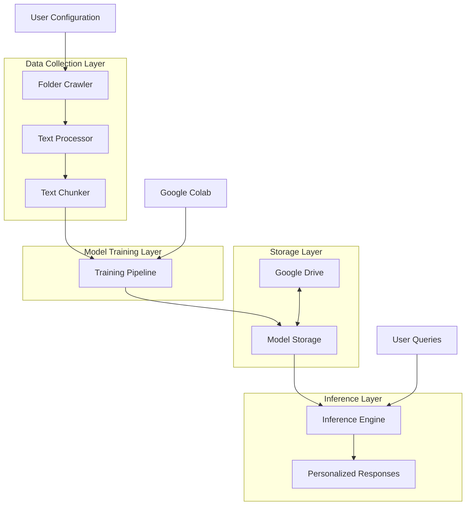
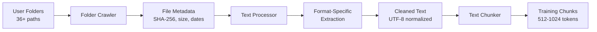
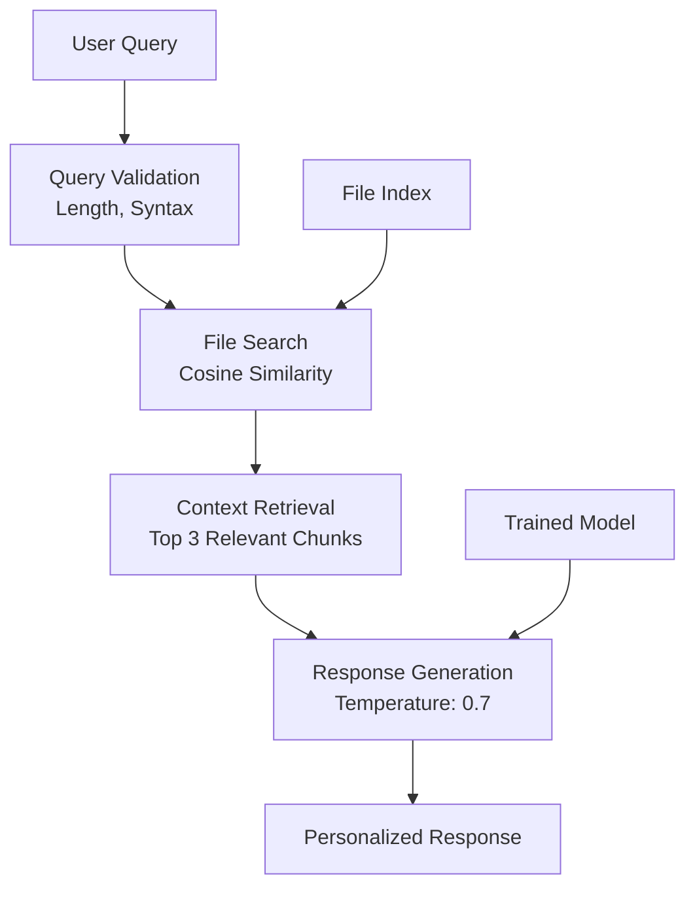
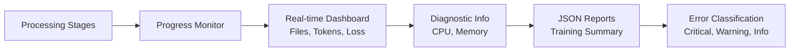

# Design Document: Personal Folder Trained Agent

## Overview

The Personal Folder Trained Agent is a system that enables users to create personalized AI agents fine-tuned specifically on their personal folder structure and content. The system crawls user-specified directories (minimum 36 folders), extracts text from multiple file formats, processes the content into training chunks, fine-tunes a Qwen 2.5-3B model on this personal data, and provides an inference interface for querying the trained agent about file content and organization.

**Core Value Proposition:** Unlike generic AI assistants, this agent develops deep familiarity with the user's personal organizational patterns, file contents, and domain-specific knowledge contained within their documents.

**Key Capabilities:**
1. **Folder Structure Comprehension:** Understands hierarchical organization and file relationships
2. **Content Understanding:** Extracts and learns from diverse document formats
3. **Personalized Responses:** Provides context-aware answers based on actual file content
4. **Optional Cloud Backup:** Local processing with optional Google Drive storage

**Research Findings Incorporated:**
1. **Qwen 2.5-3B Model:** Latest open-source model with 3B parameters, well-suited for fine-tuning on personal data [Hugging Face](https://huggingface.co/Qwen/Qwen2.5-3B-Instruct)
2. **Text Extraction Libraries:** Specialized libraries for each format: pdfplumber (PDF), python-docx (DOCX), openpyxl (XLSX), python-pptx (PPTX), tiktoken for token counting
3. **Google Colab Integration:** Optimized for GPU acceleration and Google Drive storage

## Architecture

### System Architecture Diagram



### Architectural Decisions and Rationales

1. **Modular Pipeline Design:** Components are loosely coupled with well-defined interfaces, allowing independent development, testing, and replacement of individual components.

2. **Local Processing Default:** Core processing occurs locally on the user's machine or Colab instance. Cloud storage is optional for backup and sharing.

3. **File Format Specialization:** Each supported format uses its optimal extraction library rather than a generic approach, ensuring higher accuracy and better handling of format-specific features.

4. **Progressive Training:** Checkpointing and resume capability allows training to survive Colab session timeouts and system interruptions.

5. **Dual Storage Strategy:** Models saved locally with optional Google Drive backup provides reliability while maintaining cloud accessibility.

### Technology Stack

**Core Python Libraries:**
- `transformers` (v4.45+): For Qwen 2.5-3B model loading and fine-tuning
- `accelerate` (v0.30+): For distributed training optimization
- `trl` (v0.10+): For reinforcement learning from human feedback integration
- `tiktoken` (v0.7+): For accurate token counting with Qwen's tokenizer
- `sentence-transformers` (v3.0+): For semantic similarity search in inference

**File Processing:**
- `pdfplumber` (v0.11+): PDF text extraction with layout preservation
- `python-docx` (v0.8+): DOCX file processing
- `openpyxl` (v3.1+): XLSX spreadsheet extraction
- `python-pptx` (v0.6+): PPTX presentation text extraction
- `pandas` (v2.0+): CSV/Excel data handling

**Infrastructure:**
- `google-auth`, `google-auth-oauthlib`, `google-auth-httplib2`: Google Drive OAuth2
- `google-colab`: Colab environment detection and optimization
- `fastapi` (v0.110+): Optional web interface for inference

## Components and Interfaces

### 1. Folder Crawler (`folder_crawler.py`)

**Responsibilities:** Recursively traverses specified directories, collects file metadata, maintains file references, and handles permission errors gracefully.

**Interface:**
```python
class FolderCrawler:
    def __init__(self, config: CrawlerConfig):
        """
        config: CrawlerConfig with max_depth, folder_paths, exclusion_patterns
        """
        
    def crawl(self) -> List[FileMetadata]:
        """Returns list of FileMetadata objects for all accessible files"""
        
    def get_statistics(self) -> CrawlStatistics:
        """Returns statistics about crawled files"""
```

**Key Methods:**
- `process_directory(path, depth)`: Recursive directory traversal up to depth 10
- `collect_file_metadata(file_path)`: Extracts metadata including SHA-256 hash
- `handle_permission_error(file_path, error)`: Logs error and continues

### 2. Text Processor (`text_processor.py`)

**Responsibilities:** Extracts text from various file formats using format-specific libraries, cleans text, handles encoding issues, and manages unsupported formats with a fallback mechanism.

**Interface:**
```python
class TextProcessor:
    def __init__(self, config: ProcessorConfig):
        """
        config: ProcessorConfig with extraction settings for each format
        """
        
    def extract_text(self, file_path: str, file_metadata: FileMetadata) -> TextExtractionResult:
        """Extracts and cleans text from file"""
        
    def get_supported_formats(self) -> List[str]:
        """Returns list of supported file extensions"""
```

**Format Handlers:**
- `PDFHandler`: Uses pdfplumber with layout preservation
- `DOCXHandler`: Uses python-docx with paragraph extraction
- `XLSXHandler`: Uses openpyxl with sheet and cell extraction
- `PPTXHandler`: Uses python-pptx with slide text extraction
- `CSVHandler`: Uses pandas for structured data
- `TextHandler`: Plain text with encoding detection (fallback for unsupported formats)

### 3. Text Chunker (`text_chunker.py`)

**Responsibilities:** Splits large documents into manageable chunks (512-1024 tokens), preserves sentence boundaries, counts tokens accurately, and maintains source references.

**Interface:**
```python
class TextChunker:
    def __init__(self, tokenizer, max_chunk_size: int = 1024):
        """
        tokenizer: Qwen 2.5 tokenizer for accurate token counting
        max_chunk_size: Maximum tokens per chunk
        """
        
    def chunk_document(self, text: str, source_metadata: SourceMetadata) -> List[TextChunk]:
        """Splits document into chunks preserving context"""
        
    def count_tokens(self, text: str) -> int:
        """Accurate token count using Qwen tokenizer"""
```

**Chunking Strategies:**
- `SentenceAwareChunker`: Splits at sentence boundaries when possible
- `ParagraphAwareChunker`: Preserves paragraph structure
- `FixedSizeChunker`: Fixed token size chunks with overlap

### 4. Training Pipeline (`training_pipeline.py`)

**Responsibilities:** Manages end-to-end training process, installs dependencies, prepares data splits, configures hyperparameters, monitors training, and handles recovery.

**Interface:**
```python
class TrainingPipeline:
    def __init__(self, config: TrainingConfig):
        """
        config: TrainingConfig with hyperparameters, data paths, checkpoint settings
        """
        
    def train(self, text_chunks: List[TextChunk]) -> TrainingResult:
        """Executes full training pipeline"""
        
    def resume_from_checkpoint(self, checkpoint_path: str) -> TrainingResult:
        """Resumes training from saved checkpoint"""
```

**Training Configuration:**
- Base Model: Qwen 2.5-3B-Instruct
- Epochs: 3 (configurable 1-10)
- Batch Size: 2 (adjustable for memory constraints)
- Learning Rate: 2e-5 (range 1e-6 to 1e-3)
- Gradient Accumulation: 4 steps (configurable 1-16)
- Precision: bf16 for GPU efficiency
- Max Length: 1024 tokens

### 5. Model Exporter (`model_exporter.py`)

**Responsibilities:** Saves trained models to local storage, creates metadata files, handles Google Drive upload with user credentials, and creates versioned archives.

**Interface:**
```python
class ModelExporter:
    def __init__(self, config: ExportConfig):
        """
        config: ExportConfig with output paths and cloud options
        """
        
    def export_model(self, model, training_metadata: TrainingMetadata) -> ExportResult:
        """Saves model and metadata to configured locations"""
        
    def upload_to_google_drive(self, local_path: str, drive_folder_id: str) -> UploadResult:
        """Uploads model to Google Drive using authenticated user credentials"""
```

**Export Features:**
- Local storage with organized directory structure
- Google Drive integration with OAuth2 authentication
- Versioned archives with ISO 8601 timestamps (personal_agent_v{major}.{minor}.{patch}_{timestamp}.zip)
- Pickle protocol version 4+ for model serialization
- Comprehensive metadata JSON (file counts, token statistics, hyperparameters, performance metrics)

### 6. Inference Engine (`inference_engine.py`)

**Responsibilities:** Loads trained models, processes user queries, performs semantic search on file content, generates responses, and handles error conditions.

**Interface:**
```python
class InferenceEngine:
    def __init__(self, model_path: str, file_index: Optional[FileIndex] = None):
        """
        model_path: Path to trained model
        file_index: Optional index for file content search
        """
        
    def generate_response(self, query: str, context_files: List[str] = None) -> InferenceResult:
        """Generates response using trained model within 30 seconds"""
        
    def search_files(self, query: str, top_k: int = 3) -> List[SearchResult]:
        """Searches file content using cosine similarity with sentence-transformers"""
```

**Query Processing:**
- Query validation (max 2000 characters, syntax checking)
- Context retrieval from top 3 relevant file chunks
- Response generation with temperature=0.7, max_new_tokens=512
- Graceful handling of inaccessible files (notify user, continue with available files)

### 7. Configuration Manager (`config_manager.py`)

**Responsibilities:** Loads and validates YAML configuration files, provides defaults, and reports validation errors clearly.

**Interface:**
```python
class ConfigurationManager:
    def __init__(self, config_path: str):
        """
        config_path: Path to YAML configuration file
        """
        
    def load_configuration(self) -> SystemConfiguration:
        """Loads and validates configuration from YAML file"""
        
    def validate(self, config: dict) -> List[ValidationError]:
        """Validates configuration, returns list of errors"""
```

**Configuration Schema:**
- Folder paths (absolute or relative)
- File filters (glob patterns like *.txt, *.md)
- Exclusion patterns (paths to skip)
- Training hyperparameters with validated ranges
- Chunking strategy selection (fixed_size, sentence_aware, paragraph_aware)
- Model architecture selection (Qwen2.5-3B, Qwen2.5-7B, Qwen2.5-14B)
- Cloud integration settings (Google Drive folder, credentials path)

### 8. Progress Monitor (`progress_monitor.py`)

**Responsibilities:** Monitors pipeline progress, displays real-time statistics, generates reports, handles timeouts, and provides diagnostic information.

**Interface:**
```python
class ProgressMonitor:
    def __init__(self, output_dir: str):
        """
        output_dir: Directory for saving progress reports
        """
        
    def update_progress(self, stage: str, current: int, total: int, details: Dict = None):
        """Updates progress display and logs"""
        
    def generate_report(self) -> ProgressReport:
        """Generates comprehensive JSON report"""
```

**Monitoring Features:**
- Real-time progress display (files processed, tokens extracted) updated every 10 seconds
- Training metrics (loss to 4 decimal places, steps completed, ETA in minutes) updated every 30 seconds
- System resource monitoring (CPU %, memory MB) for files taking >60 seconds
- Error tracking and classification
- JSON report generation saved to disk and accessible via web interface or file system

## Data Models

### Core Data Structures

```python
@dataclass
class FileMetadata:
    """Metadata for a single file"""
    path: str
    size_bytes: int
    extension: str
    last_modified: datetime  # ISO 8601 format
    sha256_hash: str
    processing_status: FileStatus  # PENDING, PROCESSED, ERROR, SKIPPED

@dataclass  
class TextExtractionResult:
    """Result of text extraction from a file"""
    file_metadata: FileMetadata
    extracted_text: str
    extraction_method: str
    error_message: Optional[str]
    processing_time_ms: int

@dataclass
class TextChunk:
    """A chunk of text for training"""
    text: str
    source_file: str
    chunk_index: int
    byte_offset: int
    token_count: int
    chunk_id: str  # Format: {file_path}:{chunk_index}
    metadata: Dict[str, Any]  # Additional context

@dataclass
class TrainingMetadata:
    """Metadata about training session"""
    training_id: str
    start_time: datetime
    end_time: Optional[datetime]
    hyperparameters: Dict[str, Any]
    data_statistics: DataStatistics
    performance_metrics: PerformanceMetrics
    checkpoint_paths: List[str]

@dataclass
class InferenceResult:
    """Result of inference query"""
    query: str
    response: str
    processing_time_ms: int
    context_files: List[str]
    confidence_score: float
    tokens_generated: int

@dataclass
class ModelMetadata:
    """Metadata saved alongside trained model (model_metadata.json)"""
    file_count: int
    total_tokens: int
    folder_list: List[str]
    epochs: int
    learning_rate: float
    batch_size: int
    final_loss: float
    training_duration_seconds: float
```

### Database Schema (Optional SQLite for Metadata)

```sql
CREATE TABLE files (
    id INTEGER PRIMARY KEY,
    path TEXT UNIQUE NOT NULL,
    size_bytes INTEGER,
    extension TEXT,
    last_modified TIMESTAMP,
    sha256_hash TEXT,
    processing_status TEXT,
    processed_at TIMESTAMP
);

CREATE TABLE text_chunks (
    id INTEGER PRIMARY KEY,
    file_id INTEGER REFERENCES files(id),
    chunk_text TEXT NOT NULL,
    chunk_index INTEGER,
    byte_offset INTEGER,
    token_count INTEGER,
    embedding_vector BLOB,  -- Optional for semantic search
    FOREIGN KEY (file_id) REFERENCES files(id)
);

CREATE TABLE training_sessions (
    id INTEGER PRIMARY KEY,
    session_id TEXT UNIQUE,
    start_time TIMESTAMP,
    end_time TIMESTAMP,
    model_path TEXT,
    hyperparameters_json TEXT,
    final_loss REAL,
    status TEXT
);
```

## Data Flow and Processing Pipeline

### Stage 1: Data Collection (Requirements 1-2)



**Processing Steps:**
1. **Directory Traversal:** Recursive crawl up to depth 10, skipping permission-denied files
2. **Metadata Extraction:** File size, modification dates (ISO 8601), SHA-256 hashes for integrity
3. **Format Detection:** Based on file extension, select appropriate extraction library
4. **Text Extraction:** Specialized extraction for each format; fallback to plain text for unsupported formats before logging warning and skipping
5. **Text Cleaning:** Remove Unicode control characters (U+0000 to U+001F, excluding tab/LF/CR), normalize whitespace, normalize line endings to LF
6. **Chunking:** Split documents >100KB into 512-1024 token chunks (tiktoken cl100k_base estimation, Qwen tokenizer for final count) with sentence boundary preservation

### Stage 2: Model Training (Requirements 3-4)


**Training Configuration:**
- **Data Split:** 80% training, 20% validation (deterministic seed 42)
- **Base Model:** Qwen 2.5-3B-Instruct from Hugging Face
- **Hyperparameters:**
  - Epochs: 3 (configurable 1-10)
  - Batch Size: 2 (adjustable based on GPU memory)
  - Learning Rate: 2e-5 (validated range 1e-6 to 1e-3)
  - Gradient Accumulation: 4 steps (configurable 1-16)
  - Precision: bf16 (GPU) or fp32 (CPU)
  - Max Length: 1024 tokens
- **OOM Recovery:** On out-of-memory, reduce batch size by 50% and restart from last checkpoint
- **Success Criteria:** Final validation loss < 1.5 AND convergence (loss reduction positive AND < 0.01 between last two epochs)

### Stage 3: Model Export (Requirement 4)

**Export Pipeline:**
1. **Precondition Check:** Training completed successfully AND files > 0 AND tokens > 0
2. **Local Save:** Save trained model to configured output directory
3. **Metadata Generation:** Create `model_metadata.json` with training stats
4. **Archive Creation:** Create versioned zip archive (`personal_agent_v{major}.{minor}.{patch}_{timestamp}.zip`)
5. **Serialization:** Pickle protocol version 4+ for Python 3.8+ compatibility
6. **Cloud Upload (Optional):** If Google Drive credentials are configured and connection established, upload model and metadata with user confirmation (even if local save fails)

### Stage 4: Inference and Query Processing (Requirement 5)



**Query Processing Flow:**
1. **Input Validation:** Check query length (<2000 chars), validate syntax; return error and stop processing for invalid queries
2. **Model Loading:** Deserialize pickle file, verify integrity via checksum
3. **Context Retrieval:** Search file content using sentence-transformers cosine similarity (top 3 chunks)
4. **Response Generation:** Generate response using fine-tuned model (temperature=0.7, max_new_tokens=512, timeout 30s)
5. **File Access Handling:** If referenced files are inaccessible, notify user which files couldn't be accessed and continue with available files

### Stage 5: Monitoring and Reporting (Requirement 8)



## Security and Privacy Considerations

### Data Protection Strategy

**Local Processing Architecture:** All core processing occurs on the user's machine or Colab instance. Cloud storage (Google Drive) is optional and uses the authenticated user's credentials for upload.

**Security Controls:**

1. **Permission Verification:** Before reading any file, the system checks that the current user has read permissions. Files where the user lacks read permissions are skipped.

2. **Restricted Resource Handling:** If a security permission violation is detected (e.g., attempt to access restricted system folders), the system logs a warning with violation details to the system log and skips the restricted resource.

3. **Temporary File Management:** Temporary files are stored in the system's standard temporary directory (`tempfile.gettempdir()`) and deleted when processing completes or is terminated.

4. **Input Validation:** User inputs validated to prevent injection or path traversal:
   - Folder paths validated for existence
   - Configuration validated against schema
   - Query inputs validated for length and syntax

### Compliance with Requirements

**Requirement 6 Implementation:**
- **6.1 Cloud Storage:** Model files and metadata uploaded to configured Google Drive folder using authenticated user credentials
- **6.2 Security Violations:** Log warning with violation details and skip restricted resources
- **6.3 Permission Checking:** Check file read permissions before reading; skip files without read access
- **6.4 Temp File Cleanup:** Use standard temp directory; delete temp files on completion or termination

### Risk Mitigation Strategies

| Risk | Mitigation | Implementation |
|------|------------|----------------|
| **Unauthorized File Access** | Permission checking before read | OS-level permission verification |
| **Restricted Folder Access** | Detection and skip | Log warning and continue processing |
| **Stale Temp Files** | Cleanup on completion | `atexit` handler + explicit cleanup |
| **Model Poisoning** | Input validation | File format validation, size checks |
| **Resource Exhaustion** | Processing limits and timeouts | 60s per-file timeout, batch size adjustment |

## Correctness Properties

*A property is a characteristic or behavior that should hold true across all valid executions of a system—essentially, a formal statement about what the system should do. Properties serve as the bridge between human-readable specifications and machine-verifiable correctness guarantees.*

### PBT Applicability Assessment

**Decision: Property-based testing (PBT) is NOT fully appropriate for this system as a whole, but IS applicable to specific pure-logic components.**

**Rationale:**

The system as a whole involves infrastructure operations (file I/O, network calls, GPU training) that make end-to-end PBT impractical. However, several core components contain pure logic suitable for property-based testing:

1. **Text cleaning/normalization** — pure string transformations
2. **Token counting and chunking** — deterministic algorithms with clear input/output
3. **Configuration validation** — pure validation logic
4. **Metadata generation** — deterministic data transformations

Components NOT suitable for PBT:
- File system traversal (side effects, I/O)
- Model training (non-deterministic, expensive)
- Google Drive upload (external service)
- Inference generation (non-deterministic model output)

### Prework and Property Analysis

The following acceptance criteria were analyzed for PBT applicability:

**Suitable for PBT:**
- Text cleaning (Req 2.1): For any string with control characters, cleaning should remove exactly the specified characters while preserving allowed ones
- Token chunking (Req 2.3-2.4): For any document, all resulting chunks should be within the 512-1024 token range
- Chunk metadata (Req 2.5): For any chunk, its metadata should contain all required fields (file path, chunk index, byte offset, token count)
- Configuration validation (Req 7.2, 7.4): For any hyperparameter value, the validator correctly accepts values in valid ranges and rejects values outside
- Training data split (Req 3.2): For any dataset with seed 42, the split is deterministic and maintains 80/20 ratio
- Model export naming (Req 4.4): For any version and timestamp, the archive name follows the required format

**Not suitable for PBT (use integration/unit tests instead):**
- File traversal behavior (Req 1.1-1.4): I/O side effects
- Format-specific extraction (Req 2.2): External library behavior
- Training convergence (Req 3.6): Non-deterministic
- Google Drive upload (Req 4.3): External service
- Inference response quality (Req 5.3): Non-deterministic model output
- Progress display timing (Req 8.1-8.2): UI/timing behavior

### Property 1: Text Cleaning Preserves Allowed Characters

*For any* input string, the text cleaning function SHALL remove all Unicode control characters in the range U+0000 to U+001F (excluding U+0009 tab, U+000A line feed, U+000D carriage return) and SHALL preserve all other characters unchanged. The output string with allowed control characters removed should be a subsequence of the input.

**Validates: Requirements 2.1**

### Property 2: Chunk Token Count Bounds

*For any* document larger than 100KB processed by the Text Chunker, every resulting chunk SHALL have a token count between 512 and 1024 tokens (inclusive) as measured by the Qwen 2.5-3B tokenizer. Any chunk exceeding 1024 tokens SHALL be rejected for further splitting.

**Validates: Requirements 2.3, 2.4**

### Property 3: Chunk Metadata Completeness

*For any* text chunk produced by the system, its associated JSON metadata SHALL contain all required fields: file path (non-empty string), chunk index (non-negative integer), byte offset (non-negative integer), and token count (positive integer matching the actual token count of the chunk text).

**Validates: Requirements 2.5**

### Property 4: Configuration Validation Correctness

*For any* hyperparameter value, the Configuration Manager SHALL accept values within valid ranges (learning_rate: 1e-6 to 1e-3, batch_size: 1 to 16, epochs: 1 to 10, gradient_accumulation_steps: 1 to 16) and SHALL reject values outside these ranges with a clear validation error listing the invalid parameter and expected format.

**Validates: Requirements 7.2, 7.4**

### Property 5: Deterministic Training Split

*For any* dataset of text chunks, applying the 80/20 training/validation split with seed 42 SHALL produce identical splits across multiple invocations. The training set SHALL contain exactly 80% of the data (rounded) and the validation set SHALL contain the remainder.

**Validates: Requirements 3.2**

### Property 6: Model Archive Naming Format

*For any* valid semantic version (major.minor.patch) and timestamp, the Model Exporter SHALL produce an archive name matching the pattern `personal_agent_v{major}.{minor}.{patch}_{YYYY-MM-DDTHH-MM-SS}.zip` where the timestamp is in ISO 8601 format.

**Validates: Requirements 4.4**

## Error Handling

### Error Classification System

**Severity Levels (Requirement 9.5):**
1. **CRITICAL:** Stops entire pipeline, requires user intervention
   - Examples: Out-of-memory during training (after batch size reduction fails), complete disk failure
   - Action: Terminate processing, save state if possible, alert user with recovery instructions

2. **WARNING:** Allows continuation with degraded functionality  
   - Examples: Unsupported file format, corrupted file, encoding issue, permission denied on individual file, security permission violation on restricted folder
   - Action: Skip problematic item, log warning with details, continue processing

3. **INFO:** Normal operational messages
   - Examples: File processed successfully, checkpoint saved, progress update
   - Action: Record in log, no user intervention needed

### Recovery Mechanisms

**Training Recovery (Requirement 9.2):**
```python
class TrainingRecovery:
    def save_checkpoint(self, model, optimizer, epoch, step, metadata):
        """Saves complete training state for recovery after each epoch"""
        checkpoint = {
            'model_state_dict': model.state_dict(),
            'optimizer_state_dict': optimizer.state_dict(),
            'epoch': epoch,
            'step': step,
            'metadata': metadata,
            'timestamp': datetime.now().isoformat()
        }
        torch.save(checkpoint, f"checkpoint_epoch_{epoch}.pt")
    
    def resume_from_checkpoint(self, checkpoint_path):
        """Resumes training from saved checkpoint (model weights + optimizer state + metadata)"""
        checkpoint = torch.load(checkpoint_path)
        model.load_state_dict(checkpoint['model_state_dict'])
        optimizer.load_state_dict(checkpoint['optimizer_state_dict'])
        return checkpoint['epoch'], checkpoint['step']
    
    def handle_interruption(self):
        """When no checkpoint exists (first run), restart from beginning"""
        if not self.checkpoint_exists():
            return self.restart_training()
        return self.resume_from_checkpoint(self.latest_checkpoint_path())
```

**File Processing Recovery (Requirements 1.4, 9.1):**
```python
class ErrorHandler:
    def handle_file_error(self, file_path, exception, severity):
        """Handles file processing errors based on severity"""
        error_record = {
            'file_path': file_path,
            'error_type': type(exception).__name__,
            'error_message': str(exception),
            'severity': severity,
            'timestamp': datetime.now().isoformat(),
            'resolution_suggestion': self._get_suggestion(exception)
        }
        
        if severity == 'CRITICAL':
            raise ProcessingTerminatedError(error_record)
        elif severity == 'WARNING':
            self.logger.warning(f"Skipping {file_path}: {exception}")
            return None  # Continue processing other files
        else:  # INFO
            self.logger.info(f"Note for {file_path}: {exception}")
            return None
```

### Automatic Retry Logic (Requirement 9.4)

For transient failures (network timeouts, temporary file locks):
```python
def retry_operation(operation, max_retries=3, delay_seconds=5):
    """Implements retry logic for transient failures: max 3 retries, 5 seconds apart"""
    for attempt in range(max_retries):
        try:
            return operation()
        except TransientError as e:
            if attempt < max_retries - 1:
                time.sleep(delay_seconds)
                continue
            else:
                raise PermanentError(f"Failed after {max_retries} attempts: {e}")
```

### Actionable Error Messages (Requirement 9.3)

Error messages include:
- Specific Python exception type and details
- Affected file paths
- Step-by-step recovery instructions for common failure scenarios

## Integration with Existing Tools

### Google Colab Optimization (Requirement 10)

**Environment Detection:**
```python
def detect_colab_environment():
    """Detects Colab via COLAB_GPU or IN_COLAB environment variables"""
    colab_env = os.environ.get('COLAB_GPU') or os.environ.get('IN_COLAB')
    
    if colab_env:
        return {
            'environment': 'google_colab',
            'gpu_available': torch.cuda.is_available(),
            'memory_optimization': True,
            'checkpoint_interval': 1800,  # Save to Drive every 30 minutes
        }
    return {'environment': 'local'}
```

**Colab-Specific Optimizations:**
1. **GPU Selection:** Automatically selects available GPU in Colab
2. **Memory Optimization:** Memory-efficient data loading configured automatically
3. **Drive Integration:** Mounts Google Drive for data access and model storage
4. **Session Recovery:** Saves progress to Drive every 30 minutes to survive timeouts; implements retry logic and local caching for failed saves
5. **Template Notebooks:** Ready-to-run Colab notebooks with pre-configured cells

**Note:** GPU optimizations are also allowed outside Colab environments.

### Google Drive Integration (Requirement 10.1)

**Authentication:**
- OAuth2 via user-provided `credentials.json` file
- Or interactive browser authentication

**Backup Strategy:**
- Regular checkpoints saved every 30 minutes (configurable)
- Model versions archived with timestamps
- Upload with user confirmation when Drive credentials are configured

### Performance Benchmarks

**Expected Performance in Colab (T4 GPU):**
- **File Processing:** 100-500 files/minute (depends on format)
- **Training Speed:** 500-1000 tokens/second
- **Memory Usage:** ~8GB VRAM for Qwen 2.5-3B fine-tuning
- **Total Training Time:** 2-8 hours for 10K-50K text chunks

**Local Machine Performance (RTX 3080):**
- **File Processing:** 200-1000 files/minute
- **Training Speed:** 1000-2000 tokens/second
- **Memory Usage:** ~6GB VRAM with optimizations
- **Total Training Time:** 1-4 hours for same dataset

## Testing Strategy

### Overview

This system employs a multi-layered testing strategy combining property-based testing for pure logic components with integration and end-to-end tests for I/O-heavy components.

**Testing Approach:**
- **Property-based tests** for pure logic (text cleaning, chunking, validation, naming)
- **Unit tests** for specific examples and edge cases
- **Integration tests** for component interactions with mocked dependencies
- **End-to-end tests** for complete pipeline validation
- **Snapshot tests** for output consistency

### Property-Based Testing Implementation

**Library:** `hypothesis` (Python property-based testing framework)
**Configuration:** Minimum 100 iterations per property test

**Property Tests:**

```python
# Feature: personal-folder-trained-agent, Property 1: Text Cleaning Preserves Allowed Characters
@given(st.text())
@settings(max_examples=100)
def test_text_cleaning_preserves_allowed(text):
    result = clean_text_content(text)
    # No forbidden control characters remain
    for ch in result:
        if ord(ch) <= 0x1F:
            assert ch in ('\t', '\n', '\r')

# Feature: personal-folder-trained-agent, Property 2: Chunk Token Count Bounds
@given(large_document_strategy())  # generates documents > 100KB
@settings(max_examples=100)
def test_chunk_token_bounds(document):
    chunks = chunker.chunk_document(document, metadata)
    for chunk in chunks:
        token_count = tokenizer.count_tokens(chunk.text)
        assert 512 <= token_count <= 1024

# Feature: personal-folder-trained-agent, Property 4: Configuration Validation Correctness
@given(st.floats(min_value=1e-6, max_value=1e-3))
@settings(max_examples=100)
def test_valid_learning_rate_accepted(lr):
    errors = config_manager.validate({'learning_rate': lr})
    assert len(errors) == 0

@given(st.floats().filter(lambda x: x < 1e-6 or x > 1e-3))
@settings(max_examples=100)
def test_invalid_learning_rate_rejected(lr):
    errors = config_manager.validate({'learning_rate': lr})
    assert len(errors) > 0
```

### Unit Testing (Specific Examples and Edge Cases)

**Testable Components:**
- Text cleaning with specific control character inputs
- Token counting with known text
- Configuration with edge-case values (boundaries)
- File metadata extraction with synthetic files
- Error message formatting

**Example:**
```python
def test_text_cleaning_specific():
    """Verifies specific control character removal"""
    dirty_text = "Hello\x00World\t\n\rTesting\x1F"
    clean_text = clean_text_content(dirty_text)
    assert '\x00' not in clean_text
    assert '\x1F' not in clean_text
    assert '\t' in clean_text
    assert '\n' in clean_text
```

### Integration Testing (Component Interactions)

**Test Scenarios:**
- **Folder Crawler → Text Processor:** Verify metadata flows correctly
- **Text Processor → Text Chunker:** Verify chunking receives clean text
- **Configuration Manager → All Components:** Verify config propagation
- **Error Handler → Progress Monitor:** Verify error reporting
- **Model Exporter → Google Drive:** Verify upload with mocked API

**Mock Strategy:** Use `unittest.mock` to simulate:
- File system operations (`os`, `pathlib`)
- External library calls (`pdfplumber`, `python-docx`)
- Google Drive API calls
- Model training calls

### End-to-End Testing (Complete Pipeline)

**Test Configurations:**
1. **Minimal Pipeline:** 1 folder, 3-5 test files, quick training (1 epoch)
2. **Error Recovery:** Simulate interruptions and verify resume from checkpoint
3. **Multi-Format:** Process all supported formats and verify output
4. **Large Dataset:** Stress test with many files to verify progress monitoring

**Test Data Strategy:**
- Synthetic test files in various formats (PDF, DOCX, XLSX, PPTX, TXT, MD, CSV, JSON, XML)
- Controlled folder structures with known hierarchies
- Error test cases (corrupted files, permission denied, unsupported formats)

### Test Implementation Plan

**Testing Framework:** `pytest` with plugins:
- `pytest-mock` for mocking
- `pytest-cov` for coverage reporting
- `hypothesis` for property-based testing

**Test Directory Structure:**
```
tests/
├── property/
│   ├── test_text_cleaning_properties.py
│   ├── test_chunking_properties.py
│   ├── test_config_validation_properties.py
│   ├── test_split_properties.py
│   └── test_naming_properties.py
├── unit/
│   ├── test_text_processing.py
│   ├── test_config_validation.py
│   ├── test_token_counting.py
│   └── test_error_handling.py
├── integration/
│   ├── test_folder_crawler_integration.py
│   ├── test_training_pipeline.py
│   └── test_inference_engine.py
├── e2e/
│   ├── test_complete_pipeline.py
│   └── test_error_recovery.py
├── fixtures/
│   ├── test_files/           # Synthetic test documents
│   ├── test_configs/         # Test configuration files
│   └── test_models/          # Small test models
└── conftest.py               # Shared fixtures and configuration
```

**Coverage Targets:**
- **Property Tests:** All 6 correctness properties implemented with 100+ iterations each
- **Unit Tests:** 80%+ coverage of pure business logic
- **Integration Tests:** Critical path coverage (main data flows)
- **Error Handling:** Test all error classification and recovery paths

## Deployment and Operations

### Environment Requirements

**Minimum System Requirements:**
- **Python:** 3.8+ (3.10+ recommended)
- **RAM:** 8GB minimum (16GB+ recommended for training)
- **Storage:** 10GB+ free space for models and data
- **GPU:** Optional but recommended for training (NVIDIA GPU with 8GB+ VRAM)

**Dependency Installation:**
```bash
# Core dependencies
pip install transformers>=4.45 accelerate>=0.30 trl>=0.10
pip install tiktoken>=0.7 sentence-transformers>=3.0
pip install datasets langchain-text-splitters

# File processing dependencies  
pip install pdfplumber>=0.11 python-docx>=0.8
pip install openpyxl>=3.1 python-pptx>=0.6 pandas>=2.0

# Google integration
pip install google-auth>=2.0 google-auth-oauthlib>=1.0
pip install google-auth-httplib2>=0.1

# Testing
pip install pytest pytest-mock pytest-cov hypothesis

# Optional web interface
pip install fastapi>=0.110 uvicorn>=0.29
```

### Configuration Management

**Configuration File Format (YAML):**
```yaml
# config.yaml
folders:
  paths:
    - "C:/Final S24"
    - "C:/tmp"
    - "C:/Go4Garage Products"
  max_depth: 10
  exclude_patterns:
    - "*.log"
    - "*.tmp"
    - "node_modules/**"
  file_filters:
    - "*.txt"
    - "*.md"
    - "*.pdf"
    - "*.docx"

processing:
  chunking:
    strategy: "sentence_aware"  # fixed_size, sentence_aware, paragraph_aware
    max_tokens: 1024
    min_tokens: 512

training:
  model: "Qwen2.5-3B-Instruct"  # Qwen2.5-3B, Qwen2.5-7B, Qwen2.5-14B
  epochs: 3
  batch_size: 2
  learning_rate: 2e-5
  gradient_accumulation_steps: 4
  max_length: 1024
  checkpoint_dir: "./checkpoints"

storage:
  local_output: "./output"
  google_drive:
    enabled: false
    folder_id: null
    credentials_path: null  # Path to credentials.json for OAuth2

monitoring:
  output_dir: "./reports"
  web_interface: false
```

### Operational Procedures

**Setup Process:**
1. **Install Dependencies:** Run dependency installation
2. **Configure Paths:** Edit YAML config with folder paths, filters, exclusions
3. **Validate Config:** Run validation to check for errors
4. **Initial Processing:** Start with small subset of folders to verify
5. **Monitor Progress:** Watch progress monitor for issues
6. **Review Results:** Check output quality and adjust configuration

**Maintenance Tasks:**
- **Regular Backups:** Schedule automated model backups to Google Drive
- **Log Rotation:** Configure log file rotation and cleanup
- **Dependency Updates:** Regular security updates for dependencies
- **Performance Monitoring:** Track processing times and resource usage
- **Error Review:** Regular review of error logs for patterns

---

## Review and Approval

This design document addresses all requirements specified in `requirements.md` and provides a comprehensive technical blueprint for implementing the Personal Folder Trained Agent system. The design incorporates:

1. **Modular Architecture** with clear component boundaries
2. **Practical Security** with permission checking and standard temp file handling
3. **Robust Error Handling** with severity classification and recovery
4. **Google Colab Integration** with environment-specific optimizations
5. **Comprehensive Testing Strategy** combining property-based and traditional testing

The system is designed to be **practical, maintainable, and well-tested** while meeting all functional and non-functional requirements.

**Next Steps:**
1. User review of this design document
2. Feedback incorporation and iteration
3. Task breakdown and implementation planning
