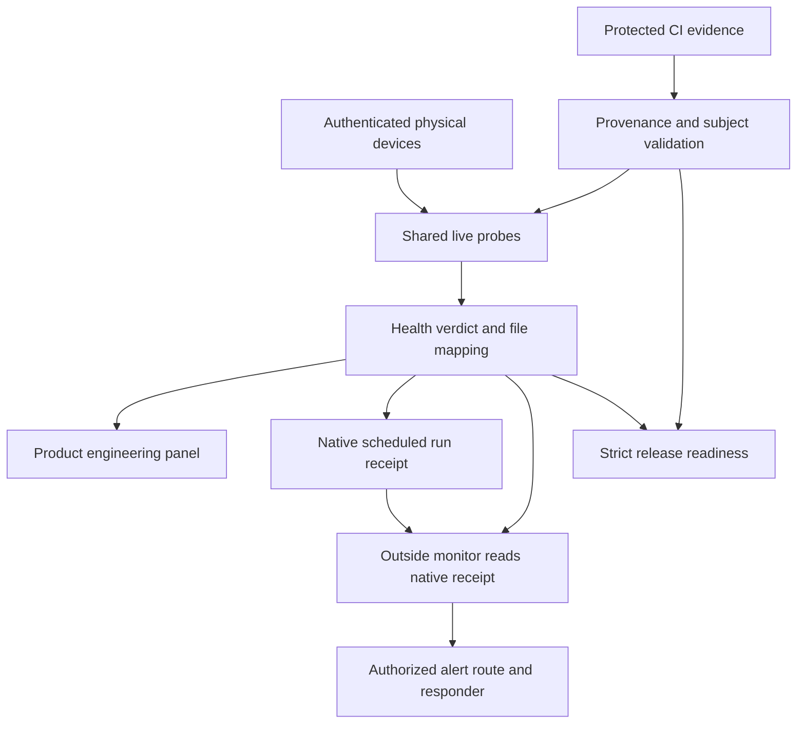
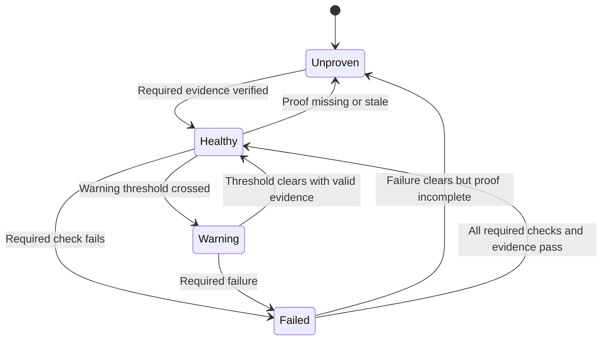

# Production Readiness - Plan

## Goal Capsule

- **Objective:** The owner can use jaytipargal.tech's essential journeys and trust its Product engineering panel to detect and explain real production problems around the clock.
- **Means:** Repair health verdicts, recover the real devices, attach trustworthy evidence to unproven checks, and release through verified CI (KTD1-KTD6).
- **Authority:** Current owner instructions and `project/CONTRACT.md` govern execution. The repository-authoritative `project/audit/SKILL.md` must be verified before pipeline work. This plan does not change those controls or approve a release.
- **Execution:** Planning and read-only source inspection only have been performed. No tests, migrations, device commands, deployments, credential changes, merges, or production repairs were run.
- **Stop conditions:** Unverified identities or targets, STOP on the current remote state branch, missing independent approval for protected controls, untrusted evidence, or uncertain production writes stop dependent work.
- **Who finishes:** Scoped implementers prepare reviewed changes; the separately authorized verifier validates evidence; the CI deployer releases only the approved candidate; the owner accepts release and handover.

---

## Product Contract

### Summary

Make the existing dashboard, device reporting, data paths, and unattended monitoring work and prove that they work. Close every required failing or unproven check before release. Preserve truthful failure reporting throughout the repair.

### Problem Frame

The owner reports **30 ok, 6 failing, 0 warning, 2 unproven**, with a recent unattended run recording `fail`. HTTP 200 and a READY deployment establish availability of the deployment, but do not establish device liveness, complete user journeys, recoverability, or effective monitoring.

The source maps file rows onto shared dependency probes. A single failed device-freshness probe can therefore produce all six failing rows. Two other rows are permanently UNKNOWN in the current code. The monitoring workflow can also succeed while cloud dependencies are failing. These are distinct problems with different proof requirements.

### Evidence Baseline

Snapshot collected across 2026-10-21/22; refresh runtime facts before implementation.

| Subject | Evidence obtained | Limit |
| --- | --- | --- |
| Local source | Checkout `jpbir`, branch `main-tracking`, HEAD `d08ca25385296313b443fff7900d0b5366522ff9`; origin `eka-auto/jpbir` | Local branch is not permission to push or merge main |
| Production hosting | Vercel connector returned project `jpbir`, ID `prj_47peuCvcDnURmUqhU3aFlaBP351J`, team `team_gcqCiU4UgkhcUJGRGLZYaQiW`, production deployment `dpl_H1hzbgVy2Q4fhxT5zZ8NeZHR521E` READY and apex aliases | Deployed commit and current runtime probe details were not independently retrieved; commit `d08ca253` and HTTP 200 are owner-supplied |
| Failure count | `Backend/lib/stack-map.js` binds exactly six file rows to `devices` | This explains the reported count as a strong hypothesis; authenticated live `probes.devices.byDevice` must confirm the actual cause |
| Unproven rows | `Devices/S24/runtime_contract.json` and `Database/scripts/migrate.mjs` use `static`; `runProbes()` hardcodes UNKNOWN | A source file's existence cannot prove its runtime behavior |
| Device verdict | `deviceFreshness()` in `Backend/jp-stack.js` uses only `lastSeen`; future times can pass | Does not apply existing strict S24 attestation |
| Cron verdict | `Backend/stack-cron.js` records the snapshot before sending alerts, and can return HTTP 200 with `overall: fail` | Recent recorded failure proves a run was recorded, not that the product is healthy or an alert was delivered |
| Independent monitor | `.github/workflows/health-check.yml` reads live stack health but neither calls `stack-cron` nor checks its last-run age; cloud failures produce a successful degraded result | Its comments overstate missed-scheduler detection |
| Overall/UI verdict | Snapshot overall and navigation dot can be green despite UNKNOWN rows; alert recovery treats every non-fail state as healthy | A clean verdict and recovery message can overstate available evidence |
| Access drift | GitHub connector identity `eka-auto` has admin on repository ID `1350770272`; access register grants write on the former `jaytipargal/jpbir` target. Local CLI uses personal identity `jaytipargal` | Authenticated governed reads/changes stop after detecting the mismatch; do not switch identities to bypass it |
| Run state | Cached `origin/project-state` at `3e504fc7` has no STOP and reports 4/34 tasks Done | Cached state is not proof of current remote STOP, CI billing, protections, or completion |
| Skill pin | LF-normalized local skill is 162031 bytes, SHA-256 `d6791d5aec3c3ccd7462bfdf04e949e8a52302627ffd755839a0bc92f2c24d1a`, matching the recorded restoration | Windows CRLF file differs in raw bytes; verify authoritative Git blob bytes remotely before execution, rather than treating line endings as tampering |

### Requirements

**Truthful health and monitoring**

- R1. Every required component has an explicit healthy, failed, warning, or unproven verdict, with an evidence timestamp and scope; unproven required evidence prevents an all-green readiness claim.
- R2. The panel preserves the current 38 mapped rows and their coverage unless an explicitly reviewed mapping change adds coverage; it separately explains unique probes, actual devices, and inherited file counts.
- R3. Scheduler execution, health measured during that execution, and alert-delivery outcome are distinguishable; manual runs cannot refresh proof of an unattended schedule.
- R4. A required failure, missing evidence, malformed response, or missed scheduled run prevents the strict production-readiness gate from passing. Failures remain visible while repair PRs are validated.

**Working product**

- R5. Every in-scope physical device earns its own verdict through current identity, authenticated runtime evidence, and freshness. No laptop writer, future timestamp, replay, or another device's heartbeat can make the S24 healthy.
- R6. The two currently static rows obtain verifiable evidence appropriate to the deployed runtime contract and migration tooling, with source, target, configuration, and relevant digest binding.
- R7. Dashboard authentication, analytics, per-device views, data browser, readable-chat inventory, authorized media access, and the configured agent flow work across browser, API, and real backing services using safe validation data.
- R8. Nightly warehouse repair demonstrates a completed or legitimate no-op run and reconciled results; credential presence alone cannot prove it worked.

**Safe release and operations**

- R9. Source targets, scoped identities, required checks, verifier independence, environment isolation, and release approvals satisfy `project/CONTRACT.md` before their dependent actions.
- R10. Recovery drills cover production data, configuration, infrastructure, and application artifacts; a Git backup alone is insufficient.
- R11. Release and operations evidence identifies the exact candidate, approved configuration, target, time, producer, result, and retained proof. Only the authorized verifier records task completion through the existing events pipeline.
- R12. The release has measured service levels, a tested rollback or forward-recovery path, a named responder, and a handover that a fresh session can follow.

### Scope Boundaries

This is stabilization and production readiness for the existing product. Reuse the current `Frontend/`, `Backend/`, `Integrations/`, `Database/`, device runtime, and hosting path. Preserve existing unrelated untracked work, including the draft requirements plan.

No frontend framework rewrite, new agent platform, fleet-record repointing, fabricated heartbeats, cosmetic status changes, secret exposure, or direct production shell deployment is included. Missing permission is a blocker. Required security, recovery, and release-integrity controls cannot be deferred to obtain green.

### Acceptance Examples

- AE1. Covers R1-R2, R5: one stale S24 can explain six inherited red file rows, while the panel names the affected device and preserves healthy verdicts for other devices.
- AE2. Covers R1, R6: missing, forged, expired, wrong-target, or wrong-revision evidence keeps its row unproven and release readiness closed.
- AE3. Covers R3-R4: browser polls and manual checks continue to succeed while the native scheduler stops; the outside monitor still reports the missed schedule.
- AE4. Covers R1, R3: a dependency changes from failed to unproven; no all-checks-passing recovery notification is emitted.
- AE5. Covers R7, R9: a valid dashboard user completes a supported journey; a caller without its required credential gets the intended refusal without data exposure.
- AE6. Covers R10-R12: restore into a clean isolated target succeeds within the confirmed RPO/RTO, and recovery evidence is available before production release.

---

## Planning Contract

### Key Technical Decisions

- KTD1. **Fix causes and evidence before colors.** Preserve file-level indicators, but derive strict readiness from required probes and verified evidence (R1-R6). A new report cannot establish trust in itself. Keep compatibility fields explicit when response semantics expand.
- KTD2. **Reuse canonical device attestation.** Connect stack health to `Backend/lib/s24-attestation.js` and the current broker's hardware rules (R5). Recover existing supported device-initiated channels first; a physical action is requested only when no verified remote execution path can perform the recovery.
- KTD3. **Separate the observation from the observer.** Retain bounded probe timeouts and separate native Vercel, outside GitHub, and manual receipts (R3-R4). The outside monitor reads native history without updating it. It does not prove the native scheduler by invoking its endpoint itself.
- KTD4. **Use existing CI artifacts and stores for the two proofs.** A protected CI producer supplies release-bound contract/migration validation; the application verifies provenance and subject binding before consuming a minimal projection (R6, R11). Use existing Firestore operational storage where a current runtime receipt is needed, with a read-only consumer identity and narrowly scoped producer. Do not add a new Postgres operations table or a second migration ledger.
- KTD5. **Separate change validation from operational readiness.** PR checks can validate a safe repair against the known degraded baseline without requiring an offline physical device to pass a unit test. A separate strict release/operations gate must require every mandatory live capability (R4, R9). This separation permits repair without certifying a broken product as release-ready.
- KTD6. **Keep the current deployment unit and manifest.** Use `project/environment/` and trusted CI, then validate and promote a configuration-bound candidate through the approved Vercel deployment path (R9-R12). Do not rebuild an approved candidate without renewing its evidence. A Render agent, if confirmed current, has its own matched release receipt; old droplet instructions do not authorize deploying there.

### Assumptions and Proposed Acceptance Thresholds

These are planning proposals where the owner has not confirmed the release-specific criterion.

- A1. Preserve the existing tier targets from `project/PROFILE.md` and TR-106/107: 99.5% availability, API p95 at most 1 second, RPO at most 24 hours, RTO at most 24 hours. Confirm their measurement boundary and expected load before acceptance. The four-second multi-dependency health probe needs its own measurement boundary; it must not silently claim compliance with the user-facing API target.
- A2. Require a clean 24-hour production observation window after candidate validation, including at least one real nightly repair opportunity. The current 38 rows should become 38 proven, zero failed, zero warning, zero unproven. Any additional required coverage also must pass.
- A3. At the configured five-minute native and fifteen-minute outside cadences, detect a native receipt older than twenty minutes. The outside monitor must alert within its next completed interval, with its own lateness monitored. Delays and missing samples are failures of proof, not inferred success.
- A4. Confirm the current broker fleet and physical identities during U1/U3. A logical record named for ASUS is not proof of ASUS hardware if its hostname identifies the Lenovo.
- A5. The historical R1 cleanup-only scope and stale registry are context, not approval to expand a release. The owner must approve this production-readiness scope and required capability matrix before implementation crosses that boundary.

### High-Level Technical Design

### Dependencies and Release Risks

U1 clears authority and environment prerequisites. U2 establishes verdicts; U3 and U4 supply the missing device/evidence capabilities; U5 makes monitoring dependable; U6 proves user journeys; U7 validates release and recovery; U8 demonstrates sustained operation. Work with an unmet prerequisite remains blocked; unrelated read-only planning can continue.

Vercel can deliver duplicate or overlapping cron invocations and does not retry failed jobs automatically. Use an expiring lock, idempotent receipt/notification processing, bounded timeouts, and observable retry state in U5, using the existing store ([Vercel cron management](https://vercel.com/docs/cron-jobs/manage-cron-jobs)).

GitHub scheduled runs can be delayed or dropped and public-repository schedules can be disabled after inactivity. GitHub therefore supplies a second observation path, not a guarantee of continuous coverage; U5 must prove how its own absence reaches a responder ([GitHub scheduled workflows](https://docs.github.com/en/actions/reference/workflows-and-actions/events-that-trigger-workflows#schedule)).

Do not assume rollback changes active cron configuration or reverses data changes. U7 verifies the deployed scheduler and configuration after rollback, and uses compatible migrations with a forward-recovery option ([Vercel cron rollback behavior](https://vercel.com/docs/cron-jobs/manage-cron-jobs)).

---

## Implementation Units

### U1. Reconcile authority, scope, targets, and the execution environment

**Goal:** Establish a valid starting point for governed production work. **Requirements:** R9, R11-R12. **Dependencies:** Owner scope confirmation and scoped provider access.

**Files:** `project/ACCESS.md`, `project/targets.json`, `project/settings.json`, `project/PROFILE.md`, `project/BRD.md`, `project/TRD.md`, `project/registry.md`, `project/traceability.md`, `project/decisions.md`, `project/environment/{Dockerfile,compose.yaml,run}`, `.github/workflows/`; existing state-branch event and approval locations. Protected-file changes need their required reviewers.

**Approach:** Resolve identity and immutable repository ID against the current provider state. Reconcile the owner/repository move, actual deployment and agent host, and separate author/verifier/deployer permissions. Refresh remote STOP and state without editing generated trackers. Verify the remote skill bytes and recorded digest. Confirm all mandatory capabilities and SLO boundaries. Preserve local work, then use an isolated checkout with separate per-run services, no production credentials, restricted access/egress, and the one manifest. Remove any CI path that bypasses that entry point.

**Test scenarios:**

1. An old target name, excessive privilege, missing verifier, or current STOP fails preflight before a write.
2. A fresh CI run uses the pinned manifest and isolated backing services; another run cannot observe its mutable test state.
3. A deliberately failing candidate is blocked by the actual required checks; an author's claimed verifier identity cannot resolve tasks.

**Verification:** Provider identity/protection receipts, confirmed scope, exact environment revision, and authoritative tracker audit evidence. Existing cached reports cannot satisfy this unit.

### U2. Make health and readiness verdicts truthful

**Goal:** Prevent unknown or failed required capabilities from yielding a green readiness claim. **Requirements:** R1-R4; AE1-AE4. **Dependencies:** U1 for execution.

**Files:** `Backend/jp-stack.js`, `Backend/lib/stack-map.js`, `Backend/stack-cron.js`, `Frontend/index.html`, `_shared/tests/stack-health.test.mjs`; proposed `e2e/stack-readiness.spec.mjs`.

**Approach:** Characterize existing payloads first. Retain per-path overrides and inherited file counts; add clear probe/device counts and a strict required-evidence verdict. Apply KTD1 to snapshot overall, navigation, card summaries, health-key projection, and recovery notifications. Define warning/unproven transitions explicitly. Reject invalid/future observation timestamps and stale browser data. Retain the distinction between fetched time and device/receipt time.

**Test scenarios:**

1. One failed device probe explains six file rows without claiming six failed devices.
2. Zero failures plus a required UNKNOWN cannot produce a green readiness/nav verdict or an all-passing recovery email.
3. A timeout, malformed body, HTTP error, empty evidence set, or stale response remains visible and does not reuse a previous green result.
4. Healthy paths remain healthy when one independent asset path fails; narrow health responses expose no device telemetry or secrets.

**Verification:** Stack unit suite and browser tests demonstrate the same verdict for equivalent states.

### U3. Recover each actual device and use strict device evidence

**Goal:** Resolve the likely shared device failure without manufacturing liveness. **Requirements:** R5; AE1. **Dependencies:** U1-U2.

**Files:** `Backend/jp-stack.js`, `Backend/lib/s24-attestation.js`, `Backend/broker.js`, `Backend/jp-devices.js`, `Devices/S24/runtime_contract.json`, existing device bundles and declared runtime manifests; `_shared/tests/{stack-health,s24-attestation,s24-action-gate}.test.mjs`.

**Approach:** Confirm live `byDevice` output and the exact failure signature before repair. Reuse canonical attestation and per-device broker identity rather than writing a second liveness contract. Follow each existing supported recovery path and keep laptop aliases distinct from hardware. Demonstrate device-originated heartbeats and an authorized harmless command with a matched completed acknowledgement. Apply the current replay, signature, and runtime rules to accepted evidence. If the physical device has no usable execution channel, keep this work blocked with the smallest concrete owner action.

**Test scenarios:**

1. A future, expired, replayed, unsigned, wrong-hardware, or laptop-originated S24 signal cannot be healthy.
2. Every enrolled fleet member is judged independently; a missing device cannot disappear from the denominator.
3. A legitimate device restarts, resumes authenticated reporting, completes a harmless command, and stays fresh through the observation window.

**Verification:** Exact-device and runtime receipts from declared executors, with attestation regression coverage. Cloud database reachability cannot substitute for these receipts.

### U4. Replace the two static placeholders with trustworthy proofs

**Goal:** Earn the remaining runtime-contract and migration-tooling lights. **Requirements:** R6, R9, R11; AE2. **Dependencies:** U1-U3.

**Files:** `Backend/lib/stack-map.js`, `Backend/jp-stack.js`, `Devices/S24/runtime_contract.json`, `Database/scripts/migrate.mjs`, migration assets and current ledger tooling, `.github/workflows/`; proposed `Backend/lib/stack-evidence.js`, `_shared/tests/stack-evidence.test.mjs`, and a CI evidence publishing step.

**Approach:** Apply KTD4. Bind CI evidence to source revision, artifact/configuration digests, target IDs, trusted producer, check result, and proof location. Runtime-contract proof includes the attested device reporting the expected contract/bundle digest. Migration-tooling proof includes isolated fresh-apply and second-run no-op results, plus current authorized schema/ledger reconciliation for the target. A release with no new migrations need not mutate production to refresh proof. Reject unsigned/self-asserted or mismatched receipts; restrict who can publish and who can read the evidence projection.

**Test scenarios:**

1. Valid correctly bound receipts make only their covered rows proven.
2. Missing, forged, expired, wrong-workflow, wrong-target, or changed-digest receipts remain unproven and close readiness.
3. Fresh isolated schema application and a second invocation converge with no additional changes; a drifted ledger or missing migration fails.
4. A runtime contract in source without a matching attested deployed device never passes.

**Verification:** CI artifact provenance and retained reports, evidence-consumer tests, target reconciliation, and the device receipt. No new production migration is implied by this unit.

### U5. Prove unattended detection and alert delivery

**Goal:** Detect failures and missing scheduled runs without an open browser. **Requirements:** R3-R4, R11-R12; AE3-AE4. **Dependencies:** U1-U4.

**Files:** `Backend/stack-cron.js`, `Backend/jp-stack.js`, `Backend/lib/cron-auth.js`, `vercel.json`, `.github/workflows/health-check.yml`, `_shared/tests/{stack-health,cron-auth}.test.mjs`; proposed `_shared/tests/stack-monitoring.test.mjs` and the existing operations runbook location.

**Approach:** Apply KTD3. Persist separate native, outside-monitor, and manual receipts with checked time, completion, product verdict, notification result, and executor/deployment identity. Extend the narrow health projection with sufficient non-sensitive schedule evidence. Have GitHub check native receipt freshness and strict readiness. Separate diagnostic/change-validation outputs from mandatory operational failures. Verify supported Vercel schedule entitlement before changing configuration. Prove an already-authorized independent dead-man route can report GitHub silence too; if none exists, register this as an owner-dependent provisioning/cost prerequisite.

Use bounded request durations for state reads/writes and mail. Serialize overlapping ticks and deduplicate transitions. Preserve retryable delivery failure without false recovery or permanent suppression when delivery was disabled. A successful SMTP handoff is recorded separately from confirmed delivery. Real-recipient tests require the existing explicit messaging authorization or a specific approval; otherwise use a safe test sink and retain real delivery as unproven.

**Test scenarios:**

1. Native scheduler silence exceeds the agreed age while browser/manual runs stay healthy; the outside check fails and routes the incident.
2. Outside monitor silence is detected by its independent watchdog; a synthetic heartbeat cannot pass as a provider-scheduled run.
3. Duplicate/overlapping ticks emit one logical transition; timeout or failed delivery is visible and retried within bounds.
4. Failed-to-unproven and failed-to-warning do not send an all-checks-passing message; complete recovery does.
5. Incorrect cron/health credentials fail; valid narrow credentials disclose only allowlisted monitoring metadata.

**Verification:** Scheduled provider receipts, controlled staging failure/missed-run drill, test-sink notifications and authorized end-to-end delivery evidence. Keep cron health and product health separate after a rollback.

### U6. Verify and repair the actual product journeys

**Goal:** Prove user outcomes across the deployed services. **Requirements:** R7-R8, R10. **Dependencies:** U1-U5.

**Files:** Existing handlers and stores behind `/`, `/s24`, `/vivobook`, `/jteka`, `/db`, `/viewer`, `/agent`; `Backend/{_auth,verify-db,db-push,jp-stats,jp-device,jp-live-content,wa-media,agent-run}.js`, `Integrations/`, relevant migration tooling; `_shared/tests/{media-auth,wa-endpoint-auth,env-manifest}.test.mjs`, `e2e/`, `playwright.config.mjs`. Proposed `e2e/production-journeys.spec.mjs` uses an isolated synthetic staging dataset.

**Approach:** Capture the current failing runtime logs after U1 authorizes access, then repair only evidenced defects. Verify authentication, analytics ingest-to-query, each real device view, data browser, readable-text accounting, authorized media bytes, and the configured agent request-to-result path. Explicitly distinguish encrypted metadata from actual readable messages. Validate the actual current agent host rather than assuming old SSH infrastructure. Require a durable completion/failure receipt for nightly warehouse repair with reconciled totals and no-op behavior; presence of credentials is only preflight.

**Test scenarios:**

1. A synthetic analytics event becomes visible in the authorized query and UI; duplicates do not inflate results.
2. Missing/invalid credentials, expired media access, empty datasets, and slow/downstream dependencies yield correct user-visible outcomes.
3. A media request returns the expected authorized bytes/content type; a readable-chat count derives from real stored text classification.
4. An agent request completes or reports a bounded actionable failure; a health endpoint alone does not pass the journey.
5. Repair resumes after an interrupted isolated run and a repeated run preserves totals; the real scheduled run subsequently proves completion.

**Verification:** Browser-to-API-to-store staging reports plus approved read-only production smoke checks. The current local Playwright server serves static pages; passing that suite alone is not proof of a real serverless backend.

### U7. Validate the release, security, and recovery gates

**Goal:** Produce a candidate that can be released and recovered safely. **Requirements:** R9-R12; AE5-AE6. **Dependencies:** U1-U6.

**Files:** `.github/workflows/`, `project/environment/`, `project/registry.md`, `project/THREAT_MODEL.md`, `project/STANDARDS.md`, `project/traceability.md`; existing checkpoint, release, approval, readiness, and recovery/runbook locations.

**Approach:** Enforce the current contract on the exact merge candidate, using the existing test runner and isolation manifest. Cover downstream device tests when shared backend/attestation code changes. Validate source/artifact security, dependency findings, authorization, privacy, browser behavior, accessibility, and measured performance under the confirmed workload. Retain signed or provider-authenticated artifact/provenance records. Prove the real required checks reject a failing candidate.

Restore Neon data, Firestore state, Blob/media references, configuration, and application artifacts into clean authorized targets with protected/synthetic validation data. Measure RPO/RTO and reconcile invariants; do not replay production command queues during the drill. Rehearse compatible rollback/forward recovery including actual cron configuration. Present an approval packet bound to exact deployment/artifact IDs, configuration, targets, evidence, and pre-authorized halt/rollback conditions. Only CI performs production actions after approval.

**Test scenarios:**

1. Missing or failed required check, modified artifact, target drift, unsigned evidence, or expired approval blocks release.
2. A production identity cannot leak into untrusted PR tests; unauthorized requests disclose no protected data.
3. Clean-target restore meets the confirmed recovery targets and preserves data/asset invariants without replaying commands.
4. Rehearsed rollback restores the approved application/configuration and verifies schedules; incompatible data rollback uses the approved forward-recovery plan.

**Verification:** Full candidate reports, protection negative-test evidence, measured recovery report, independent verifier decisions, and exact-candidate owner release approval.

### U8. Observe production and complete operational handover

**Goal:** Establish sustained, observable operation. **Requirements:** R1-R12. **Dependencies:** U7 and approved release.

**Files:** Existing production evidence, operations runbooks, `project/registry.md`, `project/ACCESS.md`, state-branch events/reports, and owner handover records.

**Approach:** Verify the released identity and execute the approved observation window A2. Use meaningful safe traffic samples for latency and error measurements; missing samples remain unproven. Include native/outside monitoring, each device, nightly repair, backup completion, and notification delivery. Confirm a named responder and fresh-session recovery instructions. The verifier resolves tasks from primary evidence; the tracker is regenerated through its existing job. Remove abandoned experimental code before handover.

**Test scenarios:**

1. The dashboard is closed for the observation window and failures still reach the authorized responder.
2. Every required row has valid evidence for the running release, with no device masking or missed scheduled intervals.
3. A fresh session follows the handover, can find the exact release and recovery evidence, and can revoke worker access without disabling production.

**Verification:** Observation report, successful scheduled repair and backup receipts, applicable SLO measurements, verifier records, and owner handover acceptance. A 24-hour sample does not establish a long-term availability SLO by itself.

---

## Verification Contract

No commands below were run during planning. Execute them only through the verified environment entry point in isolated CI or a declared executor. New test files named above are proposed additions.

| Gate | Concrete checks | Acceptance evidence |
| --- | --- | --- |
| Health semantics | `node _shared/tests/stack-health.test.mjs`; proposed stack-evidence and stack-monitoring suites | R1-R6 cases including unknown, stale, forged, and wrong-target proof |
| Device trust | `node _shared/tests/s24-attestation.test.mjs`; `node _shared/tests/s24-action-gate.test.mjs`; declared device tests | Real matched device identities, freshness, runtime digest, and harmless command acknowledgements |
| Auth boundaries | `node _shared/tests/cron-auth.test.mjs`; `node _shared/tests/media-auth.test.mjs`; `node _shared/tests/wa-endpoint-auth.test.mjs` | Authorized behavior and expected refusals without protected content exposure |
| Full source | `npm run build`; `npm run lint`; `npm test`; Python/device suites required by current CI | Exact candidate, all applicable checks actually executed; no silent `--if-present` acceptance |
| Browser | `npm run test:browser`; staging journey suite exercising actual API/backing services | Authentication, data, device, media, agent and error flows; console/network failures accounted for |
| Data and migration tooling | Existing migration runner on isolated fresh DB, second no-op run, ledger/schema reconciliation, interrupted repair replay | Reconciled totals, no drift, no competing ledger; separately authorized production receipt |
| Release integrity | Existing tracker audit/gates and provider identity/protection checks in verified CI | Current remote STOP and permissions, trusted provenance, exact artifacts/configuration and required approvals |
| Recovery and operations | Clean-target restore, rollback rehearsal, missed-run and alert drills, A2 observation | RPO/RTO measurements, recovered invariants, schedule receipts, delivery proof and named responder |

Invalid checks return Error or Unproven rather than Pass. Record failure classification and bounded repairs under contract rule 6. Do not repeatedly rerun a check merely to obtain a passing sample.

---

## Definition of Done

The product is **not currently certified production-ready by this plan**. Completion requires all of the following:

1. U1's scope, identity, target, environment and remote-state prerequisites are verified and recorded.
2. The agreed required coverage is proven: current baseline target 38/38 green, zero failed, zero warning, zero unproven, with no deleted or weakened obligations.
3. Every in-scope physical device meets R5, and actual user journeys and nightly repair meet R7-R8.
4. Both monitoring paths and the absence of either are observable; the authorized alert route and responder have been exercised.
5. Exact-candidate CI, security, performance, recovery and release gates pass with retained primary evidence.
6. The owner approves the exact release; CI records intent and receipt; verifier-confirmed post-release observations meet the confirmed criteria.
7. The handover is accepted, generated task state agrees with verified events, and no abandoned repair code or unexplained warnings remain.

### Owner-Dependent Gates

| Gate | Recommendation | Why an owner decision is needed |
| --- | --- | --- |
| P-01: scope and acceptance | Confirm this stabilization/production-readiness scope, mandatory capabilities, A1-A3 thresholds and measurement boundaries | Existing R1 documents preserve cleanup-only scope; contract rule 15 reserves product scope and acceptance confirmation |
| P-02: authority reconciliation | Establish correctly scoped author, verifier and deployer identities for the current immutable target; review required protected-control updates | Current access/target mismatch blocks dependent external work; do not widen a worker identity to make verification pass |
| P-03: external prerequisites | Approve only concrete missing device access, watchdog service/cost, recovery resources, or real-recipient test authorization identified during U1 | Exact unmet requirements must be established before asking for permission or spending |
| P-04: production release | Approve the reviewed candidate, configuration, migration/recovery plan and halt conditions after U7 | This planning request does not authorize production deployment or a protected-control bypass |

These are gates, not approvals already granted. Ask only for the next concrete owner-dependent decision; continue independent authorized work. No task is marked Not required merely because access, budget, hardware, or evidence is missing.
